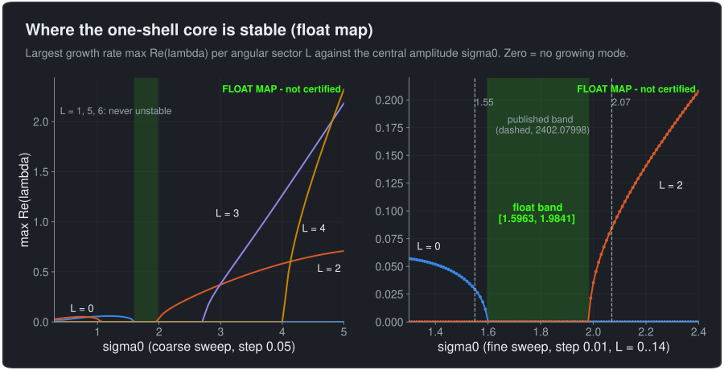
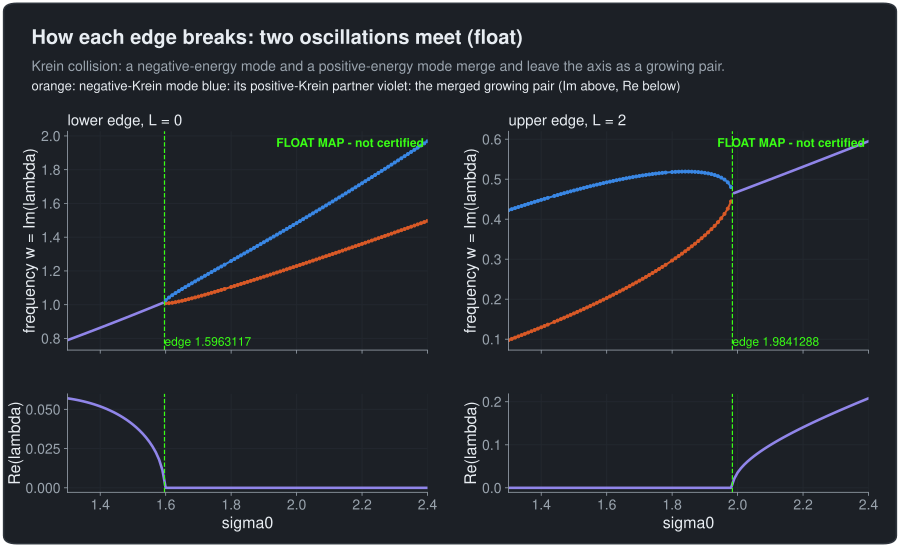

# A linearly stable excited dark-matter core, proved across its window up to 0.002-wide edge brackets: certified spectral stability of the one-node Gross-Pitaevskii-Poisson state for every central amplitude in [1597/1000, 1983/1000], and certified brackets of its stability-band edges

**Moki & Julio** (AI-assisted)

Version 2.0, 2026. Version 1.0 proved stability at nine points; version 2.0 adds Result C (Section 12): stability
for every σ0 in [1597/1000, 1983/1000]. Every number below is traced to a file of this repository in `NUMBERS.md`, and
`tools/check_numbers.py` checks each one. Certified numbers are outward-rounded balls `[mid +/- rad]` from ball
arithmetic; numbers marked **float** are double-precision values checked only by changing the resolution.

---

> **The magic trick (v2.0).** The computer builds only 23 of the cores, yet it proves that one continuous family of
> cores, one for each amplitude in between, is stable. It never computes an in-between core. It proves that the true family cannot stray
> far from a smooth guess drawn between two built cores, and that a straight-line mix of two safe operators stays
> safe as long as that small stray is smaller than a safety margin it has certified at both ends.
>
> **The magic trick (v1.0).** A computer that only does arithmetic it can prove counts every way a one-shell dark-matter
> ball could lose energy. It finds at most two in each shape class. Then it finds, in each of the three shape classes
> that have any, a wobble that provably carries negative energy, and a negative-energy wobble uses up exactly two of
> those directions. Nothing is left over for a growing mode. So no small shake of any shape can grow exponentially.

> **In plain words**
>
> If dark matter is an ultralight particle, it can settle into a ball that its own gravity holds together, with a weak
> push between the particles. Such balls are discussed as the dense cores at the centres of dark-matter halos. The
> lowest-energy ball is well understood. The next one up has a single hollow shell inside it: the field changes sign
> once on the way out. Shelled balls of this kind are usually unstable.
>
> In 2024 Chávez Nambo, Diez-Tejedor, Roque and Sarbach (arXiv:2402.07998) computed, with careful numerics, that for
> a narrow window of central densities the one-shell ball survives every small shake. To our knowledge (search of arXiv to 16 November,
> INSPIRE and Zenodo to 17-18 November 2026), nobody had proved it at any point of that window.
>
> **What we proved.** At central amplitude σ0 = 9/5 exactly, no small disturbance of any shape grows exponentially
> in time. The proof is computer-assisted: every number the computer uses carries a guaranteed error bar. The same
> certificate then holds at eight more points spread across the window, from 1.597 to 1.983.
>
> **New in version 2.0: the window up to its edge brackets.** The same holds for **every** central amplitude from 1.597 to 1.983, not
> only at the nine points: one continuous family of one-shell cores, all spectrally stable (Section 12). Together with
> the certified unstable points 1.595 and 1.985, the stable window is now pinned to within 0.002 at each end. The proof
> is computer-assisted (interval arithmetic), was checked by internal AI referee seats, and is not checked in a proof
> assistant.
>
> **What we mapped.** With ordinary (float) numerics, bisected on a refined grid and checked against a coarser one, the
> window is
> [1.5963117, 1.9841288]. That is a little narrower than the published 1.55 to 2.07. At each edge, two wobbles of
> opposite energy sign meet and turn into a growing pair: a **Krein collision**. Certified runs then pinned both edges:
> the state is proved unstable at 1.595 and stable at 1.597, stable at 1.983 and unstable at 1.985. It is also proved
> unstable at 1.55 and at 2.00, two points inside the published range.
>
> **What we did not prove.** Nothing about large shakes, long-time nonlinear behaviour, the exact edge points (they
> remain brackets of width 0.002), uniqueness of the core beyond a stated small ball, or whether real galaxies contain
> such cores. (In version 1.0 the stretches between the nine points were a float result; version 2.0 proves them.)

---

## Abstract

We study the Gross-Pitaevskii-Poisson (GPP) system, a nonrelativistic model of a self-gravitating condensate of
ultralight bosons with a repulsive quartic self-interaction, in the dimensionless units of arXiv:2402.07998. Its first
excited (one-node) spherical stationary state was reported there, from numerics, to be linearly stable for central
amplitudes 1.55 ≲ σ0 ≲ 2.07.

**Result A (certified; internally refereed; blind float replication).** At σ0 = 9/5 exactly, for every decaying one-node solution whose
central potential lies in an explicit interval of width 2·0.99·10⁻⁵⁰, the linearised operator J L on L²(R³; C²) has
no spectrum with Re λ > 0; its spectrum lies on the imaginary axis. The proof combines (i) a certified enclosure of
the background, with an existence argument; (ii) certified upper and lower brackets of the Morse indices of the
self-adjoint operators L+ (which contains the nonlocal Poisson term) and L− in every angular sector, which give the exact
indices n(L+) = (2, 1, 1, 0) and n(L−) = (1, 1, 1, 0) for L = 0..3; (iii) a constrained count at L = 0; (iv)
Krawczyk-certified purely imaginary eigenvalues of negative Krein signature at L = 0, 1, 2; (v) a direct Hamiltonian
index inequality, N₊ + 2 ≤ n(L|Y) ≤ 2, which forces N₊ = 0 in those sectors; and (vi) a monotonicity argument for
every L ≥ 3 and an assembly in three dimensions. All six negative- and positive-Krein frequencies were reproduced to
ten digits by a blind float computation that saw only the paper (sealed pass rule: relative 1e-4; the ten-digit agreement is a POST HOC observation).

**Result B (float map, certified grid and certified edge brackets) (certified; sealed; one internal referee).** A double-precision continuation in σ0 over L = 0..14 gives the
common stability band [1.5963117, 1.9841288] (edges bracketed to ±1·10⁻⁷ on the refined grid; base and refined grids agree to 3·10⁻⁷). Both edges are Krein collisions: the
L = 0 negative-Krein mode at the lower edge and the L = 2 one at the upper edge meet a positive-Krein partner and leave
the axis as a complex quartet, with the Morse indices unchanged. The sectors (L = 0 below, L = 2 above) agree with
Fig. 8 of arXiv:2402.07998. A sealed certified test (twelve points, all HOLD) proves linear stability at
1597/1000, 33/20, 17/10, 7/4, 37/20, 19/10, 39/20 and 1983/1000, and linear instability (a certified growing quartet)
at 1595/1000 and 31/20 (L = 0) and at 2 and 1985/1000 (L = 2). The float edges therefore lie in certified brackets
[1.595, 1.597] and [1.983, 1.985]. Result B by itself claims nothing between the certified points (Result C does). The
points 31/20 = 1.55 and 2 lie inside the published range 1.55 ≲ σ0 ≲ 2.07.

**Result C (v2.0; proved, computer-assisted with interval arithmetic; sealed; internally AI-refereed; not checked in a
proof assistant).** For every σ0 in [1597/1000, 1983/1000] there is a decaying one-node solution with σ(0) = σ0,
continuous in σ0, equal to the certified state at each of 23 rational nodes and unique in an explicit ball around a
cubic Hermite predictor; for each of these states the spectrum of J L on L²(R³; C²) has no point with Re λ > 0. The
proof never computes an eigenvector between the nodes. It certifies a drop in the inertia of H(w) = L + i w J between
two frequencies (the classical local Krein index identity, used here as a computer-assisted certificate), makes it
uniform on each of 22 cells by a convexity cover with closed-form chord bounds, and encloses the family of states
between two nodes by a Newton-Kantorovich argument with a residual that vanishes like t²(1 − t)² at the nodes. The
sealed bar BAR-W1 settled HOLD: 22 of 22 cells, 23 of 23 nodes and 16 of 16 controls. An independent exact-rational
checker re-applied the sealed rule to every output (0 problems); in 14 of 14 mutation tests it behaved as required
(12 planted errors caught, 2 honest variants passed). With the certified
unstable points of Result B, the stable window is bracketed to within 0.002 at each end.

---

## 1. Results

Throughout: repulsive sign s = +1, coupling α = 1 of (43b) in arXiv:2402.07998, one node (n = 1), the paper's
dimensionless units.

**Theorem A (spectral stability at σ0 = 9/5).** Let u_mid be the 60-digit number recorded in
`data/r1/target_bg_tube.json` and U0' = [u_mid − 0.99·10⁻⁵⁰, u_mid + 0.99·10⁻⁵⁰]. Take any regular solution (σ, u) of
the radial system (2.1) with σ(0) = 9/5, u(0) ∈ U0', that decays at infinity and has exactly one zero. At least one
such solution exists. Let A = J L be its linearisation (2.3) on L²(R³; C²). Then σ(A) ⊂ iR; in particular A has no
eigenvalue with Re λ > 0.

**By-product (exact indices).** n(L+(L)) = 2, 1, 1, 0 and n(L−(L)) = 1, 1, 1, 0 for L = 0, 1, 2, 3, and both are 0 for
every L ≥ 3. ker L−(0) = span(rσ) and ker L+(1) = span(rσ′); every other sector kernel is trivial.

**The certified state.**

| quantity | certified value |
|---|---|
| E (chemical potential) | [-3.10544025447 +/- 3.02e-12] |
| m = ∫σ²r²dr | [19.1587125456 +/- 4.04e-11] |
| N = 4πm | [240.755482341 +/- 4.75e-10] |
| zeros of σ on [0, 26] | 1 (node near r = 2.7853521306, float) |
| tube sha256 | f8b0cc27d5885a45af4b7356a1e3f6f2e0e1445510e32842cf4710f9ecfce28b |

**The three negative-energy wobbles** (λ = i w, Krawczyk boxes; Krein sign decided in ball arithmetic):

| L | w, negative Krein | ⟨a, d⟩ | w, positive-Krein control |
|---|---|---|---|
| 0 | [1.10491108047488 +/- 4.15e-15] | -3.061281342e-6 +/- 4.63e-13 | [1.25921337137566 +/- 6.39e-15] |
| 1 | [0.539925668013455 +/- 2.97e-16] | -6.212149350e-5 +/- 1.10e-13 | [0.951028237700108 +/- 2.59e-16] |
| 2 | [0.2968148506 +/- 6.42e-11] | -0.0002403151062 +/- 1.86e-07 | [0.5179458643 +/- 7.13e-11] |

**Result B.** Float common stability band [1.5963117, 1.9841288]; lower edge set by L = 0, upper edge by L = 2;
both edges are Krein collisions (float, Section 7). Certified (Section 7.4): stable at nine points including 9/5;
unstable at 1595/1000, 31/20, 2 and 1985/1000; edges bracketed in [1.595, 1.597] and [1.983, 1.985].

**Theorem C (v2.0; Section 12).** For every σ0 in [1597/1000, 1983/1000] there is a decaying one-node solution
Σ(σ0) of (2.1) with σ(0) = σ0 such that σ0 ↦ Σ(σ0) is continuous, Σ equals the certified node state at each of the 23
nodes of Section 12.9, and on each half-cell Σ is the unique solution in the stated X-ball of radius r_u around the
cubic Hermite predictor. For each of these states σ(J L) has no point with Re λ > 0. Proved, computer-assisted
(interval arithmetic), AI-refereed; not checked in a proof assistant.

---

## 2. Setup

### 2.1 The model (arXiv:2402.07998, eqs. (9)-(17), (32)-(33))

The dimensionless GPP system is i∂ₜψ = H(ψ)ψ with H(ψ) = −Δ + s|ψ|² + Δ⁻¹(|ψ|²), with s = +1 (repulsive
self-interaction), where Δ⁻¹f(x) = −(1/4π)∫f(y)/|x − y| dy. Stationary states ψ = e^{−iEt}σ(x) satisfy Eσ = H(σ)σ. For
radial σ and u := E − U (U = Δ⁻¹σ² the gravitational potential), (32a)-(32b) read

(2.1)  σ″ + 2σ′/r = (sσ² − u)σ,   u″ + 2u′/r = −σ²,   σ(0) = σ0, σ′(0) = 0, u(0) = u0, u′(0) = 0,

with E = u0 − ∫₀^∞σ²r dr (33). Elementary facts used throughout, with m(r) = ∫₀^r σ²t²dt and a := rσ:
r²u′ = −m(r) ≤ 0; u(r) − E = ∫_r^∞ m(t)/t² dt ∈ [0, m/r]; a″ = (sσ² − u)a.

### 2.2 Linearisation

The perturbation ansatz (18), (21) of arXiv:2402.07998 gives, after re-derivation (independently checked by two
internal referees), with C := −iB,

(2.2)  L− = −Δ + sσ² − u,   L+ = −Δ + 3sσ² − u + 2σΔ⁻¹(σ ·),

(2.3)  λ(A, C) = J L (A, C),   J = [[0, 1], [−1, 0]],   L = diag(L+, L−).

L+ contains the nonlocal Poisson term. On λ = iw with C = iD: L+A = wD and L−D = wA.

### 2.3 Sectors

Spherical harmonics (eqs. (34)-(37), (43)) reduce J L to a direct sum over (L, M) of radial operators on
X = L²(0, ∞) (reduced functions a = r·A_LM, Dirichlet at 0), each repeated 2L + 1 times:

(2.4)  L−(L) = −d² + ℓ/r² + sσ² − u,   L+(L) = −d² + ℓ/r² + 3sσ² − u + 2σG_Lσ,   ℓ = L(L + 1),

with G_L = −P_L⁻¹, P_L = −d² + ℓ/r², whose kernel is −(2L + 1)⁻¹ r_<^{L+1} r_>^{−L}. Writing L± = H0 + V± with
H0 = −d² + ℓ/r² − E ≥ |E| > 0, all of V± is bounded (the nonlocal part is Hilbert-Schmidt), so L± are self-adjoint on
D(H0). Two kernels are explicit: L−(0)(rσ) = 0 (phase) and L+(1)(rσ′) = 0 (translation).

---

## 3. Strategy

The question "does any small disturbance grow?" is a question about the non-self-adjoint operator J L. For a
Hamiltonian operator of this form, eigenvalues off the imaginary axis, and imaginary eigenvalues of negative Krein
signature, both consume negative directions of the self-adjoint operator L. We use one inequality of that kind,
proved directly in Section 4.5 (no parity theorem, no simplicity assumption):

  N₊ + 2 ≤ n(L | Y_L)   whenever a negative-Krein imaginary eigenvalue exists in the sector,

where N₊ counts eigenvalues with Re λ > 0 (with multiplicity) and n(L | Y_L) is the number of negative directions of L
on a constraint space (the phase direction is removed at L = 0). The proof therefore needs, per sector:

1. a certified **upper** count n(L | Y_L) ≤ K(L) = 2 for L = 0, 1, 2 (Sections 4.2-4.3);
2. a certified **negative-Krein eigenvalue** i w, 0 < w < |E|, for L = 0, 1, 2 (Section 4.4);
3. L±(L) ≥ ε > 0 for L ≥ 3 (Section 4.6), so those sectors have nothing to give;
4. the functional analysis that makes "eigenvalue" the only thing that can sit off the axis, and the step from
   sectors to three dimensions (Sections 4.5-4.6).

The full proof, with every lemma written out and every code fact it relies on, is
[proof/PROOF-R1-v2.md](proof/PROOF-R1-v2.md) (about 1,300 lines), shipped as the referees read it: its header line
"blind replication pending" predates the blind result (HOLD, Section 6). This section and the next condense it
faithfully; lemma numbers below are those of the proof file. In the proof, build-2/<file> is code/r1/<file> (line
numbers unchanged) and build-2/out/ is data/r1/.

---

## 4. Proof structure

### 4.1 The background (Lemmas 3.1-3.3)

**Lemma 3.1 (start, r0 = the binary64 number nearest 10⁻⁵).** For u0 ∈ U0 the regular solution exists and is unique on
[0, r0], with |σ − σ0| ≤ F r²/6 and |u − u0| ≤ sg² r²/6 (sg = 9/5 + 1/100, F = (sg² + |u0| + 1/100)sg).
*Proof:* the Volterra map V[g](r) = ∫₀^r t⁻²∫₀^t x²g dx dt is a contraction on C[0, r0] (constant < 1/2); a bootstrap
keeps σ and u within 1/100 of their centre values, far above the actual variation (below 2.5·10⁻¹⁰).

**Lemma 3.2 (existence inside the tube, s ≥ 0).** Let Esc be the set of u0 whose solution "escapes" (exactly one zero,
then u < 0 with a and a′ of one strict sign at some radius), and Z the set with at least two zeros. Both are open and
disjoint, and every escaping solution is unbounded. If the ends of an interval lie in Esc and Z respectively, some u0*
in between lies in neither, and its solution is global, decaying and has exactly one zero.
*Proof:* zeros are simple, so zero counts are locally constant in u0; escape is permanent because u ≤ u(r*) < 0 forces
a″ < 0 while a < 0; connectedness gives u0*; the certified tube then shows exactly one zero on [0, 26] with a(26) < 0
and u(26) < 0 uniformly over U0, so u0* has bounded a, a′ and the solution is global.
*Certified inputs:* lower end of U0 classified `escape`, upper end `zeros` (two zeros); existence certified; one zero on
[0, 26].

**Lemma 3.3 (tail).** For r ≥ R1 = 26, with κ1 = √(−u(26)) and a1 = |a(26)|:
|a(r)| ≤ a1 e^{−κ1(r − 26)}, |a′| ≤ (V_max/κ1)|a|, and the tails of m, I1 and E are enclosed.
*Proof:* b = −a satisfies b″ ≥ κ1² b and b′ ≤ 0; g = b′ + κ1 b obeys g′ ≥ κ1 g and is bounded, hence g ≤ 0.
*Certified:* κ1 = [1.53901484561 +/- 4.69e-12], a1 = [7.75859535966e-12 +/- 3.43e-24], u(26) = [-2.36856669502 +/- 2.38e-12],
so E < 0.

### 4.2 Certified counts (Lemmas 4.1-4.4, Theorem 4.5, Corollary 4.6)

**Lemma 4.1 (the nonlocal term, Hilbert-Schmidt).** With σ_i = σ·1_[0,R] and I_in(R) = ∫₀^R σ²r,
‖σP_L⁻¹σ − σ_iP_L⁻¹σ_i‖_HS ≤ √(I1² − I_in(R)²)/(2L + 1). So cutting the Poisson coupling at R costs at most
δ_L(R) = 2√(I1² − I_in²)/(2L + 1) in form sense. *Proof:* r_<^{L+1}r_>^{−L} ≤ √(rt).
Certified example: δ_0(10) = [0.0881154 +/- 4.45e-8].

**Lemma 4.2 (Schur complement in form sense).** For g = σa,
min over w of { P_L[w] + 2√2⟨g, w⟩ } = −2⟨g, P_L⁻¹g⟩, attained at w* = −√2 P_L⁻¹g. Hence the nonlocal form q+ is the
minimum over an auxiliary field w of a **local** 2×2 Sturm form in Y = (a, w), with potential matrix
[[ℓ/r² + 3sσ² − u − δ, √2σ], [√2σ, ℓ/r²]]. This turns the count for the nonlocal L+ into a count for a local matrix
Sturm-Liouville problem.

**Lemma 4.3 (left end).** On [0, r0] the regular matrix solution Φ = r^{L+1}Z satisfies ‖Z − I‖ ≤ c/(1 − c) with
c = r0²q/(2(2L + 3)) < 1/4; the Dirichlet-to-Neumann matrix at r0 is symmetric with spectrum in (L + 1)/r0 ± η, and a
Picone identity gives the sandwich used for the upper (U_lo) and lower (U_hi) counts.

**Lemma 4.4 (counting on [r0, R]).** For the form b[Y] = ∫(|Y′|² + Yᵀ(Q − λ)Y) + boundary terms,
n(b) = Σ_{ρ ∈ (r0, R)} dim ker Φ(ρ) + n₋((U(R) + S)|_F), with U(R) = Φ′(R)Φ(R)⁻¹. *Proof:* b-orthogonal
decomposition into the Dirichlet part and the span of solutions; the Dirichlet part by the Morse index theorem
(branch monotonicity in the endpoint). The code certifies each conjugate point as a simple zero of det Φ (sign change
plus nonvanishing derivative on a sub-interval) and the 2×2 endpoint inertia from det and trace.

**Theorem 4.5 (brackets).** With ε = 1/1000 and R ∈ {10, 14}: if the exterior margin |E| − m/R − δ_L(R) − ε > 0, then
#(L+(L) < ε) is at most the certified interior count U+ (Robin U_lo, a-shift −δ); and #(L+(L) < −ε) is at least the
count of the Dirichlet-a problem without shift (Robin U_hi). The same for L− without the w-channel.
*Proof of the upper bound:* a negative subspace of q+ − ε is mapped, through w*(a) and the cut of Lemma 4.1, injectively
into a negative subspace of the interior form; the exterior parts are nonnegative because of the margin.

Certified counts (identical at R = 10 and R = 14):

| L | upper #(L+ < ε) | lower #(L+ < −ε) | upper #(L− < ε) | lower #(L− < −ε) | exterior margin (R = 10) |
|---|---|---|---|---|---|
| 0 | 2 | 2 | 2 | 1 | [1.10045 +/- 3.65e-6] |
| 1 | 2 | 1 | 1 | 1 | [1.15920 +/- 2.79e-6] |
| 2 | 1 | 1 | 1 | 1 | [1.17095 +/- 4.08e-6] |
| 3 | 0 | 0 | 0 | 0 | [1.17598 +/- 1.10e-6] |

**Corollary 4.6 (kernel booking, exact indices).** The explicit kernel rσ is q−-orthogonal to the negative spectral
subspace of L−(0), so n(L−(0)) + 1 ≤ 2; likewise n(L+(1)) + 1 ≤ 2. With the lower counts, every upper count equals its
lower count once the kernels are booked: the exact indices of Section 1.

### 4.3 The constraint at L = 0 (Theorem 4.7)

**Theorem 4.7.** n(L+(0) restricted to (rσ)^⊥) ≤ n(B) − 1 = 1, where B is the interior 2×2 operator at level 0.
*Proof:* the constraint ⟨f, rσ⟩ = 0 moves, by Cauchy-Schwarz, onto the interior with weight M; then a direct
Haynsworth inertia argument gives n(P) = n(B) − 1 once d2 = ⟨B⁻¹G, G⟩ < 0 and M|d2| > 1.
Certified: n(B) = 2 at both radii; d2 = [-2.041380387 +/- 3.15e-10] (R = 10) and [-2.172289605 +/- 1.42e-10] (R = 14);
M|d2| = [1133.8 +/- 0.0894] and [4.775e+7 +/- 6.25e+3].

**K(L).** n(L | Y_0) ≤ [n(B) − 1] + [U−(0) − 1] = 2; n(L | Y_1) ≤ [U+(1) − 1] + U−(1) = 2; n(L | Y_2) ≤ U+(2) + U−(2) = 2;
K(3) = 0. So **K = (2, 2, 2, 0)**.

### 4.4 The negative-Krein eigenvalues (Lemmas 5.1-5.10)

For real w the eigenvalue problem is a 3-channel ODE system for (P, Q, ψ) = (a + d, a − d, Poisson field). An eigenvalue
i w is certified by matching a 3-dimensional regular subspace at 0 to a 3-dimensional decaying subspace at infinity at
r_m = 8, with a Krawczyk test on (w, v).

- **Lemma 5.1 (matched solution ⇒ eigenvector).** A real nonzero solution that is regular at 0 and decays (P, Q) with
  bounded ψ gives an eigenvector ξ = (a, i d) of A_L with eigenvalue i w: the auxiliary field is forced to equal
  G_L(σa) because the difference is harmonic, vanishes at 0 and is bounded.
- **Lemma 5.2 (Frobenius start).** Second-order Frobenius data at r0 with explicit remainders; the code's constants
  exceed the true ones by a factor of about 3.1 to 3.6 (checked in ball arithmetic, `checks/check_frob_slack.log`).
- **Lemmas 5.3-5.7 (the decaying basis on [26, ∞)).** A far-field Riccati series to order 10 with a contraction for
  the residual; an inward certified Riccati integration to r = 26; a contraction (constant θ < 1/2) for the coupled
  bounded solutions in an exponentially weighted norm; renormalisation so that every uncertainty multiplies only
  decaying directions; and Cauchy bounds on a complex disc for the w-derivative.
- **Lemma 5.9 (Krawczyk).** If K(X) ⊂ int(X), the matching determinant has a zero (w*, v*) in X, which by Lemma 5.1
  is an eigenvalue i w* with 0 < w* < |E|.
- **Lemma 5.10 (Krein sign).** ⟨Lξ, ξ⟩ = 2w*⟨a, d⟩. The sign of ⟨a, d⟩ = (1/4)∫(P² − Q²) is certified on four intervals
  (a crude bound on [0, r0], Gram quadratures on [r0, 8] and [8, 26], and the tail bound of the contraction beyond 26).

Certified values: the table in Section 1. Tail bound at L = 0: 2.44e-20; contraction constant θ = 3.69e-12.

### 4.5 Essential spectrum and the index inequality (Lemma 6.1, Theorem 6.2)

**Lemma 6.1.** On Ω = C ∖ (i(−∞, −|E|] ∪ i[|E|, ∞)), A − λ = (I + K(λ))(A0 − λ) with K(λ) compact and analytic. The
eigenvectors with Re λ > 0 span an L-isotropic space, so their number is bounded by the (finite, certified) number of
nonpositive directions of L; this supplies one resolvent point, and the analytic Fredholm theorem then shows that every
spectral point off the imaginary axis is an isolated eigenvalue with a finite-rank Riesz projection. This holds per
sector and in three dimensions.

**Theorem 6.2 (index inequality).** In a sector, let N₊ be the total algebraic multiplicity of eigenvalues with
Re λ > 0, and ξ an eigenvector for i w (w > 0) with ⟨Lξ, ξ⟩ < 0. Then N₊ + 2 ≤ n(L | Y_L).
*Proof:* (i) root spaces with λ ≠ 0 lie in the constraint space (the phase direction is annihilated); (ii) the Riesz
projections satisfy ω(P_λx, y) = ω(x, P_{−λ̄}y), so the unstable and stable root spaces E₊, E₋ are ω-isotropic and
paired nondegenerately, which yields a negative definite subspace of dimension N₊ in E₊ + E₋; (iii) span(ξ, ξ̄) is a
negative definite 2-plane ω-orthogonal to it. Their sum is negative definite of dimension N₊ + 2.

**Application.** At L = 0, 1, 2: N₊ + 2 ≤ K(L) = 2, so **N₊ = 0**.

### 4.6 All other sectors and three dimensions (Lemma 7.1, Corollary 7.2, Theorem 7.3)

**Lemma 7.1 (monotonicity in L, nonlocal term included).** q+_{L+1}(f) ≥ q+_L(f) + 2(L + 1)∫f²/r², and the same for q−.
For L+ this uses the variational formula of Lemma 4.2: P_{L+1} ≥ P_L implies ⟨g, P_{L+1}⁻¹g⟩ ≤ ⟨g, P_L⁻¹g⟩.

**Corollary 7.2.** L±(3) ≥ ε, hence L±(L) ≥ ε for all L ≥ 3, and an eigenvector with Re λ ≠ 0 would have ⟨Lx, x⟩ = 0:
impossible. **Theorem 7.3.** The sector projections commute with A (the background is radial), so a three-dimensional
eigenvalue with Re λ > 0 would give a sector eigenvalue, contradicting the above; and σ(A) = −conj σ(A) rules out
Re λ < 0. Hence σ(A) ⊂ iR.

### 4.7 What the proof rests on

- **Code facts.** Eleven properties of the instruments (proof, Section 10), audited operation by operation by an
  engine-audit seat (Taylor and tail engines, with closed-form tests and deliberately broken controls that fail) and by
  an internal referee (counting, Krawczyk, Krein Gram and tail, matching). Four latent defects off the target path
  were found; they change no number and are fixed in the R2 instruments (`code/r2/`).
- **Standard results used without opening a source** (listed in the proof, GAP B2): domain monotonicity of Dirichlet
  eigenvalues of 2×2 Sturm systems, relative compactness of decaying potentials, the analytic Fredholm theorem, the
  Krawczyk theorem, min-max, Banach's fixed point and continuous dependence, H² regularity, the multipole expansion.
- **Ball arithmetic** (Arb through python-flint 0.9.0) is trusted. No step is checked in a proof assistant.

---

## 5. Certified values

All from `data/r1/` (seal 07faff6621, amended 6ad54f5713), one background tube for all four outputs.

| quantity | value | file |
|---|---|---|
| u_mid | 3.93902357537910961270976242947912892526530674750036020337021 | target_bg_tube.json |
| E | [-3.10544025447 +/- 3.02e-12] | target-B.json `B.E` |
| m | [19.1587125456 +/- 4.04e-11] | `B.m` |
| I1 | [7.04446382985 +/- 3.92e-12] | `B.I1` |
| κ1 | [1.53901484561 +/- 4.69e-12] | `B.kappa1` |
| a1 | [7.75859535966e-12 +/- 3.43e-24] | `B.a1` |
| D1 = 3m/4 | [14.3690344092 +/- 3.03e-11] | `D1` |
| relative virial residual | [+/- 8.21e-16] | `B.virial_rel` (consistency only) |
| K | (2, 2, 2, 0) | target_verdict.json |
| verdict | HOLDS | target_verdict.json |

The Krein table is in Section 1. Counts and D0 are in Sections 4.2-4.3.

---

## 6. Controls and verification

**Sealed controls (all PASS, `data/r1/controls_verdict.json`).**

- **NULL (σ0 = 1/2, outside the band).** The same pipeline must find growth, and does: a Krawczyk-certified L = 0
  eigenvalue with Re λ ≥ 0.02413229272632793 and Im λ ≈ 0.2832272004.
- **Schrödinger-Poisson n = 1 (no self-interaction), published instabilities.** C-P2 (L = 0, a quartet; window from
  Harrison, Moroz and Tod, Table 3): Re λ ≥ 0.08827420125417403 (the 10% real-part window was set after a 7% float
  mismatch: mock-informed, disclosed in the bar; certified ratio 0.04817 vs the published 0.0451); C-P3 (L = 2, a real
  growing pair, as in Fig. 4 (right panel, first excited, ℓ = 0) of arXiv:2310.18405): λ ≥ 0.09917673961346397.
- **C-B2.** E1/E0 of Schrödinger-Poisson at equal particle number: [0.189203706825 +/- 1.76e-13], inside the sealed
  window [0.1884, 0.1896] from Harrison, Moroz and Tod, Table 1.
- **C-P1.** The nodeless repulsive state at 9/5: K(L) = 0 for L = 0..3 at both radii.
- **C-B1 (calibration, matched after the fact).** The attractive nodeless background against Fig. 5 of
  arXiv:2402.07998.
- **C-R, C-W, positive-Krein controls.** Identical counts at R = 10 and 14; the exterior Schur form is unbounded below
  as it must be; the three positive-Krein neighbours are certified positive.

**Independent checks.**

- **Blind replication (sealed, f47da860b7, HOLD).** A separate seat saw only the paper and the definition of the
  object, chose its own method (B-spline Galerkin with an exact exterior condition for the Poisson field), and was
  scored by a script against predictions hashed before it ran. It reproduced E and m, every count, all three
  negative-Krein frequencies and all three positive-Krein neighbours to all ten printed digits (sealed pass rule: relative 1e-4; the ten-digit agreement is a POST HOC observation), max Re λ ≤ 1.6·10⁻¹¹
  at L = 0..3, and the growing quartet at σ0 = 1/2 (`data/blind/`, `checks/verdict_blind.py`). It is a float
  computation: a replication, not a certificate.
- **Three non-blind float checks** by internal referees (finite differences twice, Chebyshev collocation once) agree
  with every count, all six frequencies and all six Krein signs (they saw the certified values, so they are not
  blind).
- **Proof checks** (`checks/`): the start interval U0' is contained in the computed one (tube rebuilt from scratch, same
  sha256); the Frobenius slack holds; the assembly of every certified input into K = (2, 2, 2, 0) and the six Krein
  signs is recomputed (`ALL PASS`).
- **Review.** Two internal hostile referee rounds on the design before any instrument existed (referee-1, referee-2);
  referee-3 on the sealed run (σ0 entered exactly plus four code fixes, applied through the amendment); referee-4, blind to referee-3, on the
  whole chain; an engine audit (audit-1); referee-5 on the written proof (fixes applied in v2). These are internal lab
  checks, not external peer review. R2 (the twelve-point test) was reviewed by one internal hostile referee (referee-7). It re-derived all twelve verdicts from the released files with an independent script, re-ran the Frobenius check at the eight stable points, and checked the text, the numbers and privacy. An earlier release referee (referee-6) reviewed the R1 parts of this release. The build-3 engine changes were checked by the 9/5 regression and the disc controls, not by a separate engine audit. The R2 certified points have no blind replication. These are internal lab checks, not external peer review.

---

## 7. The stability band (Result B)

### 7.1 The float map (NOT certified)

Engine: the blind seat's B-spline Galerkin code (`code/band-map/`), with three local fixes described in
`data/band-map/MAP.md`. Background tolerance 10⁻¹⁰; box radius R = max(40, 70/√(−E)); a refined level with 1.5 R,
1.67 N and degree 9.

- Coarse sweep: σ0 = 0.30..5.00 in steps of 0.05, L = 0..6. Fine sweep: σ0 = 1.30..2.40 in steps of 0.01, L = 0..14.
- **Band.** [1.5963117, 1.9841288]. Lower-edge bracket at the refined grid [1.59631162, 1.59631172]; upper-edge
  bracket [1.98412876, 1.98412883]. Width 0.38782.
- **Sectors.** On [1.3, 2.4] only L = 0 (below the band) and L = 2 (above it) are ever unstable. For L = 3..14,
  n(L+) = n(L−) = 0 at every fine-grid point, so these sectors cannot carry growth; the centrifugal term then keeps
  higher L positive (inferred, not computed beyond L = 14).
- **Further out (coarse grid).** L = 3 is unstable from 2.75 and L = 4 from 4.05 on the grid; L = 1, 5, 6 never.

### 7.2 The mechanism at each edge (float)

- **Lower edge, L = 0.** On the stable side the negative-Krein L = 0 mode (the one at w ≈ 1.105 at 9/5) rises toward a
  positive-Krein mode coming down; they merge near w ≈ 1.01476 and leave the axis as a quartet ±a ± ib, with
  a ≈ 0.1427 √(σ_lo − σ0). The collision sits at w/|E| = 0.398, well inside the gap 0 < w < |E|.
- **Upper edge, L = 2.** The lowest L = 2 mode (negative Krein, w ≈ 0.297 at 9/5) climbs and meets the second L = 2 mode
  (positive Krein) near w ≈ 0.46371; above the edge a ≈ 0.279 √(σ0 − σ_hi). The collision sits at w/|E| = 0.126.
- **Not a real crossing, not a mass extremum.** n(L+) and n(L−) are the same on both sides of each edge; the
  Vakhitov-Kolokolov quantity ⟨L+⁻¹rσ, rσ⟩ is smooth and negative (−2.2470 at the lower edge); the mass increases
  strictly along the family.
- The square-root law of the growth rate is the signature of a generic Krein collision (Hamiltonian-Hopf).

### 7.3 The certified test (sealed design, BAR-R2-EDGES, seal 3ad051728e)

Twelve points, each its own all-or-nothing certificate, with the R1 pipeline made parametric in σ0 = p/q (`code/r2/`;
changes in the bar and in PATCHES.md, part B):

- just outside each edge, a certified growing eigenvalue: 1595/1000 (L = 0) and 1985/1000 (L = 2);
- just inside each edge, the full R1 stability certificate: 1597/1000 and 1983/1000, plus a certified separation of
  the two nearly colliding modes with opposite Krein signs;
- six interior points: 33/20, 17/10, 7/4, 37/20, 19/10, 39/20 (stability certificate);
- two points inside the published band where the float map shows growth: 31/20 (L = 0) and 2 (L = 2).

If both points of an edge HOLD, that edge is bracketed in an interval of width 0.002 containing the float edge.
This bar claims stability only at the sealed points, not on the intervals between them (those are Section 12).

### 7.4 Certified outcomes (BAR-R2-EDGES settled HOLD; all twelve points HOLD; all controls PASS)

Every point HOLDS. All must-pass controls (C-B1, C-B2, C-P1, C-P2, C-P3, NULL, C-U150, C-U205) PASS under the final
instrument hashes, and the disc checks CAL-KD and CAL-ED PASS (`data/r2/controls_verdict.json`,
`data/r2/controls_r2_verdict.json`, `data/r2/R2_all_verdicts.json`). Boxes are the `refine:` lines of the run logs in
`data/r2/logs/`; as in R1, the `w` and `lam` strings in the JSON files are not used.

**Certified growing modes (linear instability proved).** A Krawczyk-certified eigenvalue with Re λ > 0 in the named
sector; the imaginary part is nonzero, so each is a quartet ±Re λ ± i Im λ:

| σ0 | sector | certified λ (Re + i Im, Krawczyk box) | verdict |
|---|---|---|---|
| 1595/1000 | L = 0 | [0.005159936765 +/- 9.79e-13] + i·[1.01371961231 +/- 4.07e-12] | HOLDS |
| 31/20 | L = 0 | [0.029367442235 +/- 6.23e-13] + i·[0.978168535545 +/- 7.14e-13] | HOLDS |
| 2 | L = 2 | [0.0353872961 +/- 2.52e-11] + i·[0.4686174535 +/- 2.65e-11] | HOLDS |
| 1985/1000 | L = 2 | [0.008240881 +/- 3.74e-10] + i·[0.463975628 +/- 5.55e-10] | HOLDS |

**Certified spectral stability at eight more points** (the full R1 certificate at each point: K = (2, 2, 2, 0) at
R = 10 and 14, D0, D1 > 0, a negative-Krein eigenvalue certified in each of L = 0, 1, 2 with its positive-Krein
neighbour certified positive, one tube sha256 per point, and the separation record):

| σ0 | verdict | K | w⁻ at L = 0 | w⁻ at L = 1 | w⁻ at L = 2 |
|---|---|---|---|---|---|
| 1597/1000 | HOLDS | (2, 2, 2, 0) | [1.01156658375 +/- 2.89e-12] | [0.454300995393917 +/- 2.58e-16] | [0.201778070 +/- 1.20e-10] |
| 33/20 | HOLDS | (2, 2, 2, 0) | [1.0231166878309 +/- 3.50e-14] | [0.476046298668078 +/- 2.95e-16] | [0.2239829738 +/- 5.79e-11] |
| 17/10 | HOLDS | (2, 2, 2, 0) | [1.04813654968334 +/- 6.83e-15] | [0.496958900414915 +/- 1.01e-16] | [0.2463961212 +/- 3.79e-11] |
| 7/4 | HOLDS | (2, 2, 2, 0) | [1.07581074350611 +/- 5.75e-15] | [0.518253661596410 +/- 3.63e-16] | [0.2705262718 +/- 4.21e-11] |
| 37/20 | HOLDS | (2, 2, 2, 0) | [1.13496776996447 +/- 1.92e-15] | [0.561969440698342 +/- 2.05e-16] | [0.3260149986 +/- 2.07e-11] |
| 19/10 | HOLDS | (2, 2, 2, 0) | [1.16574473209241 +/- 4.12e-15] | [0.584378958602663 +/- 8.78e-17] | [0.3596652774 +/- 3.80e-11] |
| 39/20 | HOLDS | (2, 2, 2, 0) | [1.19710410286268 +/- 2.65e-15] | [0.607147685016223 +/- 5.12e-16] | [0.4023308222 +/- 6.45e-11] |
| 1983/1000 | HOLDS | (2, 2, 2, 0) | [1.21807583965753 +/- 1.39e-15] | [0.622368426994779 +/- 2.65e-16] | [0.453984310 +/- 5.20e-10] |

**The two nearly colliding modes just inside each edge** (both certified, opposite Krein signs, disjoint boxes):

| σ0 | L | negative-Krein mode | positive-Krein partner | certified gap between the boxes |
|---|---|---|---|---|
| 1597/1000 | 0 | [1.01156658375 +/- 2.89e-12] (−), ⟨a,d⟩ = -1.612233679e-6 +/- 7.95e-11 | [1.01905618960 +/- 2.20e-12] (+), ⟨a,d⟩ = 1.659832199e-6 +/- 8.89e-11 | ≥ 0.007489 |
| 1983/1000 | 2 | [0.453984310 +/- 5.20e-10] (−), ⟨a,d⟩ = -2.889527238e-6 +/- 2.99e-08 | [0.472730296 +/- 5.38e-10] (+), ⟨a,d⟩ = 2.764440422e-6 +/- 2.90e-08 | ≥ 0.018745 |

**What this proves, and what it does not.**
- **Certified:** linear (spectral) stability at nine points across the window, 1597/1000, 33/20, 17/10, 7/4, 9/5 (R1),
  37/20, 19/10, 39/20 and 1983/1000; linear instability at 1595/1000 (L = 0), 31/20 (L = 0), 2 (L = 2) and
  1985/1000 (L = 2).
- **Certified edge brackets:** the state is certified unstable at 1.595 and certified stable at 1.597, and certified
  stable at 1.983 and unstable at 1.985. So a change from instability to stability lies in [1.595, 1.597] and one from
  stability to instability lies in [1.983, 1.985]. The float edges 1.5963117 and 1.9841288 lie inside these brackets.
  The certificates do not say that each transition is a single point.
- **Not certified by R2:** stability between the certified points. In version 1.0 the window
  [1.5963117, 1.9841288] as a whole was a float result: certified at nine points and float-mapped continuously in
  between. Version 2.0 proves stability on all of [1597/1000, 1983/1000] (Section 12); the parts of the float window
  outside it, [1.5963117, 1.597) and (1.983, 1.9841288], remain float results.
- **Mechanism, certified in the weak sense of the bar:** each certified growing eigenvalue just outside an edge is
  non-real (a quartet), and just inside each edge the two colliding modes are certified with opposite Krein signs and
  separated (gap at least 0.007489 at 1597/1000 and 0.018745 at 1983/1000). The collision itself is a float
  observation.
- **How the proof transfers.** The eight R2 stable points use the R1 proof chain (PROOF-R1-v2, Sections 3-7, 9.2)
  with σ0 = p/q in place of 9/5. Every point-dependent input is a certified output of that point's run and was
  re-checked from the files by the R2 referee. Those inputs are the background flags, identical counts at R = 10 and 14
  (0 at L = 3, as the L ≥ 3 argument needs), positive exterior margins, D0 (n(B) = 2, d2 < 0, M|d2| ≥ 272), K = (2, 2,
  2, 0), the three negative-Krein certificates with 0 < w < |E|, and one tube sha256. Lemma 3.1 holds with
  sg = σ0 + 1/100 (F r0²/6 ≤ 2.86e-10 at all eight points). The Frobenius slack argument does not depend on σ0.
  `checks/check_frob_slack_r2.py` repeats the 9/5 check at the eight points (ALL PASS). The parametrised instruments are
  in `code/r2/` (changes: `code/r2/PATCHES-build3.md`); the 9/5 regression with them reproduces R1
  (`code/r2/CALIBRATION.md`).
- **The start interval at each R2 point, written exactly.** `checks/check_u0_r2.py` rebuilds each point's tube in
  memory exactly as its B job did (disk cache off), confirms the tube sha256 recorded in `data/r2/<tag>/B.json`, and
  checks in 400-bit ball arithmetic that U0'_p = [u_mid − 0.99·10⁻⁵⁰, u_mid + 0.99·10⁻⁵⁰] lies inside the computed
  start interval (log `checks/check_u0_r2.log`: ALL PASS at all eight points). So the theorem of Section 1 holds as
  stated at every one of the nine points, with U0' replaced by U0'_p:

| σ0 | u_mid (60 digits) | tube sha256 |
|---|---|---|
| 1597/1000 | 3.26257829877873232632728523408544749250724679772354387125538 | `a972731286c2559b…` |
| 33/20 | 3.43211518960578683230289225606858139753236980535419033262268 | `bcf501cf76088e21…` |
| 17/10 | 3.59659207485142889921563217406404416977402901494387498760527 | `5f55659ab04e2a95…` |
| 7/4 | 3.76554052577800818868878023500042080295687479763023181911048 | `10d6a3259cff74b9…` |
| 37/20 | 4.11710126372510784661490336736586880648244811516454564809644 | `851df5904ccad216…` |
| 19/10 | 4.29983054407140852492383796452184831740940264326441840450233 | `87934ed628e76d6f…` |
| 39/20 | 4.48726521011202076693095150956315573980034448089016171545471 | `3a07fc8c0824cc63…` |
| 1983/1000 | 4.61357440252882992130093660916470009950424657162244902579940 | `2226779189e2c3ff…` |

  **Theorem A at nine points.** For σ0 ∈ {1597/1000, 33/20, 17/10, 7/4, 9/5, 37/20, 19/10, 39/20, 1983/1000}, every
  regular solution of (2.1) with σ(0) = σ0 and u(0) ∈ U0'_p (U0' at 9/5) that decays and has exactly one zero has
  σ(J L) ⊂ iR.

### 7.5 Comparison with the published band

arXiv:2402.07998 reports, for L = 0..12, a common stability band 1.55 ≲ σ0 ≲ 2.07 (Fig. 8). Our float band lies
inside it, narrower by 0.046 at the bottom and 0.086 at the top. At the published endpoints our float computation finds
growth that is identical to all nine printed digits at three resolutions: 0.029367442 ± 0.978168536 i at σ0 = 1.55
(L = 0) and 0.073523517 ± 0.48414557 i at σ0 = 2.05 (L = 2); at σ0 = 2.00 the L = 2 growth rate is 0.0354. The paper
does not state its σ0 scan step, and "≲" leaves room for a coarser grid; our float edges are bracketed to ±1·10⁻⁷
on the refined grid (base and refined grids agree to 3·10⁻⁷). Section 7.4 certifies growth at σ0 = 31/20 = 1.55 (L = 0)
and σ0 = 2 (L = 2), both inside the published range. Section 8 says how we read this.

---

## 8. Fairness and credit

- **Chávez Nambo, Diez-Tejedor, Roque and Sarbach (arXiv:2402.07998)** built everything this work stands on: the
  model and its units, the linearisation and the sector decomposition, an analytic proof that no unstable modes exist
  for large enough L (their Section IV.4), and the numerical discovery of the band itself. The sectors at the edges,
  L = 0 below and L = 2 above, are visible in their Fig. 8; we credit them for it. Our float band is narrower than their
  stated 1.55 to 2.07, and the certified test confirms the difference at two points: the stated range contains
  σ0 = 31/20 = 1.55 (its lower end, which "≲" includes) and σ0 = 2, where the state is now certified linearly unstable
  (L = 0 and L = 2, growth rates about 0.0294 and 0.0354). Their pioneering result stands in substance: a narrow stable
  window exists, it is bounded by L = 0 below and L = 2 above exactly as their Fig. 8 shows, and it contains certified
  stable points. What changes is its extent. Their text does not state the σ0 resolution of the scan behind Fig. 8,
  and "≲" marks the ends as approximate; with a refined scan, the float window is [1.5963117, 1.9841288], and its edges
  lie in the certified brackets [1.595, 1.597] and [1.983, 1.985]. We read this as a refinement of their band, made
  possible by their model, code and figures. The same group re-showed the band in their Proca-star work
  (arXiv:2512.04376).
- **What is new here, to our knowledge** (prior-art search of arXiv to 16 November, INSPIRE and
  Zenodo to 17-18 November 2026): the first rigorous proof that the first excited (one-node) GPP state is linearly stable at any
  σ0 (here at nine points); refined band edges (float) with certified brackets of width 0.002; the identification of
  both edges as Krein collisions (float); and the first
  certified Hamiltonian-Krein index argument in which a negative-Krein eigenvalue must be certified (nonzero Krein
  index), for an operator with a nonlocal (Poisson) term. Earlier rigorous results on excited states cover large L
  ([CDRS] Sec. IV.4), a toy kernel ([MM]) and a symmetry-restricted class ([CS26]). The two nonlocal counts we found
  have one negative direction and no negative-Krein eigenvalue (Cadiot, arXiv:2403.18718; analytically, Georgiev and
  Stefanov, arXiv:1702.03374).
- **For Result C (v2.0), to our knowledge** (prior-art search of arXiv to 13 November (Krein-count use) and 16-17 November (interval stability), INSPIRE and Zenodo to
  19 November 2026): we found no earlier computer-assisted proof of spectral stability for every value of a parameter
  in an interval for a Hamiltonian state with Krein-signed spectrum and a nonlocal kernel, and no earlier use of the
  local Krein index identity as a computer-assisted certificate, at a point or uniformly over a parameter interval.
  The identity itself is **classical** and is not ours: Kollar and Bosak (arXiv:1212.5691, Theorem 4, the local
  index theorem for Hermitian pencils), Kollar and Miller (SIAM Rev. 56 (2014), arXiv:1209.3185, graphical Krein
  signature; their Theorem 7 gives the finite-dimensional index count) and, earlier, Binding and Browne (1988). Our
  written proof (Section 12.3) only covers the infinite-dimensional case with essential spectrum, which Kollár and Bosák
  call straightforward. The general method class "stable for every parameter in an interval, by interval arithmetic"
  has precedents for other objects, which we credit for method: Barker (arXiv:1401.5371, roll waves: stable on a whole
  interval of periods, edges bracketed), Breden, Payan, Reisch and Tang (arXiv:2504.05066, a nonlocal reaction-diffusion
  system: stable for all δ below a bracketed threshold) and Braz e Silva (Zenodo 10.5281/zenodo.23772125, micropolar
  Couette flow: a parameter-set cover with validated Evans-function boxes). The idea of certified grid points plus a
  perturbation argument between them is in Hoang, Plum and Wieners (ZAMP 60 (2009), photonic band gaps). Barker and
  Zumbrun (arXiv:1601.00837, Remark 1.2) note in print that carrying the parameter as an interval naively is not
  computationally useful, which is why Result C never does it. Kollar and Pego (arXiv:1103.0157) track Krein signatures
  along a parameter numerically (not certified); compare their Lemma 1 with the non-degeneracy step of Section 12.3.
- **Brito, Herdeiro, Radu, Sanchis-Gual and Zilhão (arXiv:2506.06442)** studied relativistic excited boson stars by
  3+1 evolution and state that their runs do not allow them to verify the narrow band.
- **Harrison, Moroz and Tod (math-ph/0208045)** found numerically that excited Schrödinger-Newton states are radially
  unstable; their Table 1 gives our control C-B2.
- **Index theory.** The Hamiltonian-Krein accounting we use is classical (Kapitula, Kevrekidis and Sandstede;
  Kapitula and Stefanov, arXiv:1210.6005; Chugunova and Pelinovsky, math/0602386; Lin and Zeng, arXiv:1703.04016).
  We prove the one inequality we need directly.
- **Method neighbours.** Computer-assisted spectral stability for other equations: Cadiot (arXiv:2403.18718,
  arXiv:2505.03091), Beck and Jaquette (arXiv:2105.06895), van der Aalst and Cadiot (arXiv:2509.16693).
- **Our own corrections** (none of this was published): the first sealed run entered σ0 as the double nearest 1.8;
  an internal referee caught it together with an un-integrated gap in one Riccati step, float conversions of bounds,
  unasserted margins, an exterior margin without −ε and an unpinned tube cache; all were fixed under a sealed amendment
  and the run repeated at 9/5 exactly, with the same certified midpoints to every printed digit (radii differ in the
  last digits). The R2 float map found and fixed a tail-start bug in its own copy of the blind seat's background
  code. A duplicate seal of the same file is listed as VOID.

---

## 9. What we do not claim

- **The interval, not the edges.** Version 2.0 proves stability for every σ0 in [1597/1000, 1983/1000] (Section 12),
  with s = +1, α = 1, n = 1; instability is certified at the four R2 unstable points. The edges themselves are not
  located: they remain in the brackets [1.595, 1.597] and [1.983, 1.985], and the float window parts
  [1.5963117, 1.597) and (1.983, 1.9841288] are float results. An edge bracket [a, b] does not say that the transition in
  it is a single point.
- **Along the certified branch only.** Result C is about the family Σ(σ0) built in Section 12: continuous in σ0,
  equal to the certified node states, and unique in the stated X-ball of radius r_u around the predictor on each
  half-cell (and, at the 23 nodes, unique among decaying solutions whose start value lies in the node's certified
  tube). It does not exclude other decaying one-node solutions with the same σ0 outside that ball.
- **Proved, computer-assisted, not formally verified.** Result C rests on interval arithmetic (Arb through
  python-flint), on lemmas written out in `design/` and condensed in Section 12, and on internal AI referee and audit
  seats. No step is checked in a proof assistant, and none of the reviews is external peer review.
- **Linear and spectral only.** No nonlinear or orbital stability; no claim about bounded growth of the linear
  semigroup, embedded eigenvalues in ±i[|E|, ∞), or the Jordan structure at 0. For excited states of other nonlinear
  Schrödinger equations, internal modes of negative Krein signature are known to be able to cause nonlinear
  instability (Cuccagna, arXiv:0801.4237; Kevrekidis, Pelinovsky and Saxena, arXiv:1412.1522).
- **Uniqueness of the state.** Theorem A holds for every decaying one-node solution with u0 in U0'; at the R2 points,
  read U0'_p (the table in Section 7.4) for U0'. Version 2.0 adds uniqueness only in the local sense above (node tube
  and BR ball); global uniqueness of the one-node state at a given σ0 is not proved.
- **No count of imaginary eigenvalues** and no algebraic simplicity.
- **One unchecked field in the R2 verdict code.** For the unstable points, `code/r2/verdict.py` (`point_unstable`)
  does not compare the sector of the certified eigenvalue with the sealed sector, while `controls_r2` does. The sector
  comes from the fixed point table in `code/r2/assemble.py`, and the sealed sector (0, 2, 0, 2) was confirmed from the
  outputs by the R2 referee. The sealed instruments are not changed.
- **The float map certifies nothing.** Its band, edges, mechanism and growth laws are float results.
- **No astrophysical claim.** Whether such cores exist in real halos is outside this work.
- **Numerical choices** (r0, R = 10 and 14, R1 = 26, r_m = 8, ε = 1/1000, disc radii, step sizes) are fixed points of
  the computation, not claimed constants.

---

## 10. Open doors

- **Done in v2.0: stability on a whole interval.** The door that version 1.0 left open here (a perturbation argument
  between the certified points) is Result C (Section 12).
- **A Lean check of the convexity step.** Each of the 242 convexity-cover tests (22 cells, 11 certificates per cell) is
  a statement about one quadratic polynomial in t on [0, 1] with exact rational coefficients, and
  `checks/w3/check_w3.py` already decides them in exact rationals. Stating Lemma CC's quadratic step and the 242
  instances as Lean theorems would turn that part of the proof into a kernel-checked one.
  *Status:* UNTESTED; not part of any sealed test. *Start here:* `checks/w3/check_w3.py` and the cell files in
  `data/r3/cells/`.
- **Uniqueness beyond the ball.** Result C gives uniqueness only in a small X-ball around the predictor (radius r_u)
  and in the node tubes. Whether the one-node state at each σ0 in the window is unique among all decaying one-node
  solutions is open. *Status:* open. *Ceiling:* the stable window as a statement about THE first excited state.
- **The exact edges.** The edges are bracketed to width 0.002. Locating each transition to a single certified point
  (and proving that it is a single Krein collision) would need a certificate that follows the two colliding modes.
  *Status:* UNTESTED. *Start here:* the R2 separation records at 1597/1000 and 1983/1000 (Section 7.4).
- **Why L = 1 never breaks.** L = 1 carries a negative-Krein mode too (w ≈ 0.540 at 9/5), but on the whole float range
  [0.3, 5] it never collides. *Status:* UNTESTED observation from the float map. *Ceiling:* a structural reason that
  one sector of an excited core is always protected.
- **A different mechanism at large σ0.** On the coarse grid L = 3 becomes unstable from 2.75 and L = 4 from 4.05, and
  there n(L−) rises to 1 while n(L+) stays 0, which looks like a real crossing rather than a Krein collision.
  *Status:* UNTESTED; not bisected. *Start here:* `code/band-map/edge.py` at L = 3.
- **Nonlinear fate.** Whether the proved negative-energy wobbles let the core decay over long times under
  nonlinear coupling. *Status:* open; Section 9 cites the general mechanism. *Ceiling:* whether a stable excited core
  is stable in the sense that matters for halos.
- **The relativistic counterpart.** Excited boson stars with self-interaction in general relativity: the 3+1 study of
  arXiv:2506.06442 could not resolve the band. *Status:* open according to that paper. *Start here:* the certified
  Newtonian edges as targets for the relativistic family.

---

## 11. Sealed tests

| test | seal | what | verdict |
|---|---|---|---|
| R1 | 07faff6621 | spectral stability, first run (σ0 entered as the double nearest 1.8) | HOLD (superseded by the amendment) |
| R1 duplicate | dbcc9f9278 | same file sealed twice | VOID |
| R1 amendment | 6ad54f5713 | referee-3 fixes, re-run at σ0 = 9/5 exactly | HOLD |
| R1 blind | f47da860b7 | blind float replication | HOLD (PB1-PB5, PC) |
| R2 | 3ad051728e | certified edges and grid, 12 points | HOLD (all 12 points) |
| R3 (BAR-W1) | 5e6d7bfed0 | stability for every σ0 in [1597/1000, 1983/1000] (v2.0) | HOLD (22/22 cells, 23/23 nodes, 16/16 controls) |

Sealed texts: `seals/`. Every bar's predictions and pass rules were hashed before its run. The R1 predictions were
written after float smokes (mock-informed, disclosed in the bar); the R1 verdict is a certificate and cannot be moved by
them. The same holds for the R2 predictions (read off the float map, disclosed in BAR-R2-EDGES). The R1 items P1-P4
were sealed as MATCH/MISS predictions; they scored MATCH and are shown with the HOLD chip. BAR-W1 (R3) was sealed after
its controls had run (by design: controls are calibration objects, and no window node or cell was certified before the
seal); one control rule was set after seeing that control's data (the XU-1985 rule, Section 12.11), and the bar
discloses it. The shipped copies have local folder names replaced (PATCHES.md, part A); the original sha256 of each
sealed file is listed there.

---

## 12. Result C: stability for every σ0 in [1597/1000, 1983/1000] (version 2.0)

Labels in this section: **PROVED** = argument written out in `design/` (condensed here) and reviewed by internal
referee seats; **CERTIFIED** = an outward-rounded interval enclosure from the sealed run (`data/r3/`); **FLOAT** = a
double-precision probe, used for steering or as a control, never on a proof path. The lemmas are written out in
`design/DESIGN-W2.md` (Sections 3.2-3.7) and `design/DESIGN-W3.md` (Sections 3.5-3.7 and Amendment W3-A1, which
supersede W2 where they say so); `design/DESIGN-W1.md` is the first design, kept for the record. They are shipped as the
referees read them, not as a polished proof document.

### 12.1 Statement

**Theorem C.** For every σ0 in [1597/1000, 1983/1000] there is a decaying one-node solution Σ(σ0) = (σ, u) of (2.1)
(s = +1, α = 1) with σ(0) = σ0, such that:
1. σ0 ↦ Σ(σ0) is continuous, and Σ equals the certified node state at each of the 23 nodes of Section 12.9;
2. on each half of each cell, Σ is the unique solution in the X-ball of radius r_u around the cubic Hermite predictor
   H_t (the norm X is defined in 12.6; r_u is recorded as [0.0100000 +/- 1e-12] in all 44 half-cells), and at each
   node it is the unique decaying solution whose start value lies in that node's certified tube;
3. for each of these states the spectrum of J L on L²(R³; C²) has no point with Re λ > 0.

In words: spectrally stable along the certified branch, unique in the stated ball. Not claimed: uniqueness outside the
ball; the edges (they remain the R2 brackets); nonlinear stability. Status: proved, computer-assisted (interval
arithmetic), AI-refereed; not checked in a proof assistant. At the nine R2 points the node tubes are the R1/R2 tubes
(identical sha256, e.g. `a972731286c2559b…` at 1597/1000 and `f8b0cc27d5885a45…` at 9/5), so Theorem C extends
Theorem A (and its nine-point form, Section 7.4) without replacing their states.

### 12.2 The idea

Carrying σ0 as an interval through the computation does not work: the interval Taylor stepper inflates a start width
by many orders of magnitude (FLOAT probe in `design/DESIGN-W1.md`, Q2), and a parametric Krawczyk test on the
eigenvalue problem would need boxes of width about 10⁻⁵ (Q1; condition number about 3.3·10³ of the Krawczyk
Jacobian at 7/4, L = 0, FLOAT). Barker and Zumbrun say the same in print for viscous shocks ([BZ], Remark 1.2). Result
C uses three replacements instead:
1. **Counts instead of eigenvectors.** A certified drop in the number of negative directions of one fixed symmetric
   operator H(w) between two frequencies certifies negative-Krein spectrum between them (12.3).
2. **Convexity instead of interval parameters.** Along a cell the operators are, up to a certified remainder, a
   straight-line mix of the two end operators. Certified positive margins of both ends on one common explicit subspace
   then hold all along the cell (12.4).
3. **A Newton-Kantorovich branch instead of a parametric tube.** The family of states between two nodes is enclosed by a
   contraction around a cubic Hermite predictor, using only linear solves at the nodes (12.6).
Nothing on the proof path uses a Krawczyk certificate, an eigenvector or an interval-valued σ0 (DESIGN-W2, 3.7).

### 12.3 The Krein count by inertia (Lemmas KC and IDXC; classical)

For real w with |w| < |E| let H(w) := [[L+, −w], [−w, L−]], the form of L + i w J after a fixed unitary change of
variables, and N(w) := n(H(w)), its number of negative directions in a sector.

**Lemma KC (local Krein index identity).** If 0 ≤ w1 < w2 < |E| are not eigen-frequencies and S is the sum of the Riesz
spectral subspaces of J L for the eigenvalues i w, w1 < w < w2, then S is finite-dimensional and
N(w1) − N(w2) = n(h_w1 on S) − n(h_w2 on S), with n(h_w1 on S) = n(ω on S). So a certified count drop certifies
negative-Krein spectrum in i(w1, w2). **This identity is classical** ([KB] Theorem 4, eq. (14); [KMi]; [BB]); those
sources work in finite dimensions or with compact resolvent, and the extension is one which Kollár and Bosák call straightforward. DESIGN-W2, Section
3.2, writes out a proof for our operator, which has essential spectrum (above |E| − |w|) and may have Jordan chains:
Riesz projections are [·,·]-symmetric, so S and its complement are form-orthogonal for every h_w; on S the index is
constant on [0, w1]; on the complement it is constant on [w1, w2] because no eigenvalue of the restricted operator
crosses 0. A robust form allows frequencies within the counting level of w1 and w2.

**Lemma IDXC.** N₊ + 2 (N(w1) − N(w2)) ≤ n(L restricted to Y_L) ≤ K(L). With K(L) = 2 and one certified drop, N₊ = 0.
This is the Hamiltonian-Krein count plus KC ([KMi] Theorem 7 in finite dimensions). An internal referee checked it on
3999 random finite-dimensional cases with 0 violations (DESIGN-W2, 3.3).

What the gate found open is the **use**: the identity as a computer-assisted certificate (interval inertia counts at two
frequencies, no eigenvector), and uniformly over a parameter interval.

Count pattern used per sector (the drop sits across the negative-Krein frequency w− of v1.0; w1 below it, w2 between
w− and its positive-Krein partner w+):

| L | N(w1) | N(w2) | w1 | w2 |
|---|---|---|---|---|
| 0 | 4 | 3 | below w− (about 0.93 w−) | between w− and w+ |
| 1 | 3 | 2 | below w− (about 0.6 w−) | between w− and w+ |
| 2 | 2 | 1 | 0 | between w− and w+ |

The frequencies are chosen per cell by float steering (`code/r3/steer.py`); floats choose, they never decide.

### 12.4 Convexity cover and chord bounds (Lemmas CC and CH)

On a cell [a, b] of width Δ write σ0 = a + tΔ, t ∈ [0, 1], chord(f) := (1 − t) f_a + t f_b and w_t := chord(w).

**Lemma CC (convexity cover).** Upper: if both end forms are ≥ m_a, m_b on a common subspace M of codimension k, and
T ≥ chord(T) − η₂ with η₂ < chord(m), then T > 0 on M and n(T) ≤ k. Lower: if both end forms are ≤ −m_a, −m_b on a common
(k + 1)-dimensional space and T ≤ chord(T) + η₂', η₂' < chord(m), then n(T) ≥ k + 1. The certificate is the pair of
**margins on a common subspace**: end counts alone imply nothing inside.

**Lemma CH (chord inequalities).** With e_σ, e_u the pointwise distances of the true state from the chord (from BR,
12.6): η₂(t) collects the local loss (3 t(1 − t) Δσ² + 6 |σ_lin| e_σ + e_u) and the nonlocal loss
((4 n_e I_lin + 2 n_e²)/(2L + 1)); η₂' has the nonlocal convexity term on the unfavourable side and an extra 3 e_σ².
In closed form (DESIGN-W3, 3.5), η₂(t) ≤ C0 + C1 t(1 − t) and likewise η₂', with C0 of the order of the BR radius.

**Exact test.** For each certificate the condition m_a (1 − t) + m_b t − C0 − C1 t(1 − t) > 0 for all t ∈ [0, 1] is a
quadratic in t with exact rational coefficients (the printed enclosures, rounded the safe way); it is decided exactly.
For the penalised L = 0 certificate the loss is η₂ + M' Γ(t) with M' = 5.

### 12.5 Endpoint margins (Lemma CPOSL) and the 11 certificates

At each cell end the margin m is certified on the complement of k explicit vectors by a 3-channel count of an
interior form B_m on [r0, R] with R = 20 (count of conjugate points, per-step re-basing, Robin start, exterior margin),
plus a Haynsworth inertia step with k forcing columns (the Schur matrix S must be negative definite). For L = 0 the
phase constraint is handled by a penalty M' = 5 and a Sherman-Morrison sign. Each cell end carries 11 certificates:

| certificate | sectors | what it gives on the whole cell (with CC) |
|---|---|---|
| CPOS H(w2) | L = 0, 1, 2 | N(w2) ≤ 3, 2, 1 |
| RITZ H(w1) (Gram matrix on explicit trial functions) | L = 0, 1, 2 | N(w1) ≥ 4, 3, 2 |
| CPOS H(0) with k = 4, 3, 2 | L = 0, 1, 2 | L± > 0 off finitely many directions: finite index, and with the exact kernels n(L−(0)), n(L+(1)) ≤ 1 |
| count H(0), k = 0 | L = 3 | L±(3) > 0, hence every L ≥ 3 (monotonicity, PROOF-R1-v2 Lemma 7.1) |
| PEN (penalised L+(0) on (rσ)^⊥) | L = 0 | the constrained count, hence K(0) ≤ 2 |

Together: N(w1) − N(w2) ≥ 1 for L = 0, 1, 2 and K(L) ≤ 2 at every σ0 of the cell; IDXC gives N₊ = 0; L ≥ 3 and the
three-dimensional statement follow as in Theorem 7.3. The w-checks 0 ≤ w1 < w2 < |E| are certified at both ends.

### 12.6 The branch between two nodes (Lemma BR' with GREEN)

**Spaces.** ω(r) := 1 + (r/4)²; X: pairs z = (d, v) with d(0) = 0, norm max(sup |d| ω, sup |v|/s_u), s_u = 3.

**Predictor and residual.** H_t is the cubic Hermite interpolant of the two node states and their first variations
τ_a, τ_b in σ0. Its first component at r = 0 is exactly a + tΔ. The residual F(H_t) is a polynomial in t that vanishes
with its t-derivative at both ends, so F(H_t) = t²(1 − t)² Q_t exactly. The coefficients of Q_t come from a symbolic
division with remainder 0 (re-derived by an internal referee); the coded formulas are re-checked against the definition
at random points at the start of every cell job (`cell._sym_check`, float, an assertion only). No derivative of node
data appears.

**Theorem BR' (one fixed ball per half-cell).** On t ∈ [0, 1/2] linearise at node a, on [1/2, 1] at node b. With
certified Y0 (residual), Z1 (linear defect) and Z2 (nonlinear) bounds, ρ := 2 Y0/(1 − Z1), r_u ≥ ρ,
Y0 + Z1 ρ + Z2 ρ² ≤ ρ and κ(r_u) := Z1 + r_u Z2 < 1: the map is a contraction on the X-ball of radius r_u, uniformly in
t; its fixed point is the unique solution there and depends continuously on t. The two halves agree at t = 1/2
(checked: ρ of each half lies inside r_u of the other). Because the residual factor vanishes at t = 0, 1, both
neighbouring cells return exactly the node state, so the branch is continuous across nodes. If the certified tube's
X-diameter is below r_u, every decaying solution in the node tube is the node state (uniqueness in the tube). The same
bounds give E(σ0) < 0, one node, and |E(σ0)| ≥ −u(σ0)(R1) as a certified lower bound along the branch.

**GREEN (Lemma G, Lemma EXT).** The solution operator of the linearised node problem is written as an explicit
kernel in the basis {U2, V1hat, Z1, Z2} (regular and decaying solutions, each marched in its stable direction, so no
cancellation is done on boxes), with nondegeneracy α = [U2, V1hat] ≠ 0 and c = [Z1, Z2] ≠ 0 certified at every node.
The exterior r ≥ R1 = 26 is closed by a lemma for the decaying solution, a maximum principle with constant
1/(κ1² − 1/8) and Gauss's law.

### 12.7 Why no parametric Krawczyk

The R1/R2 certificate of a negative-Krein eigenvalue is a Krawczyk proof at one σ0. Over a cell the eigenvalue moves,
and near the edges its positive-Krein partner comes close (gaps 0.007489 at 1597/1000 and 0.018745 at 1983/1000,
Section 7.4). A parametric Krawczyk would have to enclose a moving eigenpair to high relative accuracy over the whole
cell. The count drop needs only two frequencies strictly inside the gap and positive margins there, which convexity
carries across the cell.

### 12.8 The sealed run

BAR-W1 (seal 5e6d7bfed0; `seals/BAR-W1.md`) fixed the schedule, the outcome rules, the controls and every parameter
before any window node or cell was computed: R = 20, s_u = 3, ω = 1 + (r/4)², M' = 5, Taylor order 24 (linear steps; 56 for the tube), precision 320
bits (tube) and 200 bits (linear steps), CC margin fraction 0.7 (fallback 0.35, never used), 8 t-sub-intervals per
half for the envelopes. A cell HOLDS only if BR' closes on both halves, both tube diameters are below r_u, one node and
E < 0 are certified, all 11 certificates at both ends are certified, every CC quadratic test passes and the w-checks
hold. There is no bisection: a cell that does not close stays INCONCLUSIVE. Instruments: `code/r3/` (21 files pinned by
sha256 in `code/r3/RUN.md`). Run: 23 node jobs then 22 cell jobs, two at a time, every job once, all exit 0
(`data/r3/logs/run_w1.log`): 81 minutes of wall time from the first to the last timestamp of that log.

### 12.9 Schedule

Nodes (23): 1597/1000, 1600/1000, 1605/1000, 1612/1000, 1625/1000, 33/20, 1675/1000, 17/10, 1725/1000, 7/4,
1775/1000, 9/5, 1825/1000, 37/20, 1875/1000, 19/10, 1925/1000, 39/20, 1962/1000, 1970/1000, 1976/1000, 1980/1000,
1983/1000. Cells c01 ... c22 are the consecutive pairs, widths 0.003 to 0.025 (narrow near the edges, where the end
margins are smallest). Per node: tube (R1 = 26), brackets at R = 10 and 14 (K = (2, 2, 2, 0) required), GREEN. Every
node gives K = (2, 2, 2, 0) at R = 10 and R = 14; E runs from -2.5529204157 at 1597/1000 to -3.6629582174 at 1983/1000
(float rendering of the certified balls; e.g. E = [-2.55292041571 +/- 4.31e-12] and [-3.66295821740 +/- 7.26e-13]).

### 12.10 Results per cell (all HOLD)

From the independent checker's log (`checks/w3/logs/check_w3.log`), which recomputes them from the cell files. Columns:
min 1 − Z1 over the two halves; max κ(r_u); max ρ/r_u; max tube X-diameter/r_u; certified lower bound of |E| on the
cell; the tightest convexity-cover test and its smallest ratio chord(m)/(C0 + C1 t(1 − t)) over t (a ratio above 1 passes).

| cell | interval | width | 1 − Z1 | κ | ρ/r_u | diam/r_u | abs(E) ≥ | tightest test | ratio | verdict |
|---|---|---|---|---|---|---|---|---|---|---|
| c01 | [1597/1000, 1600/1000] | 0.003 | 0.9647 | 0.3540 | 8.820e-10 | 5.721e-08 | 1.90632 | H(w2) L0 | 6.493 | HOLDS |
| c02 | [1600/1000, 1605/1000] | 0.005 | 0.9412 | 0.3773 | 6.949e-09 | 5.472e-08 | 1.91213 | H(w2) L0 | 8.222 | HOLDS |
| c03 | [1605/1000, 1612/1000] | 0.007 | 0.9178 | 0.4004 | 2.721e-08 | 5.071e-08 | 1.92191 | H(w2) L0 | 8.659 | HOLDS |
| c04 | [1612/1000, 1625/1000] | 0.013 | 0.8474 | 0.4704 | 3.475e-07 | 4.563e-08 | 1.93573 | H(w2) L0 | 4.620 | HOLDS |
| c05 | [1625/1000, 33/20] | 0.025 | 0.7061 | 0.6116 | 5.620e-06 | 3.750e-08 | 1.96784 | H(w2) L0 | 2.336 | HOLDS |
| c06 | [33/20, 1675/1000] | 0.025 | 0.7082 | 0.6069 | 5.443e-06 | 2.571e-08 | 2.02208 | H(w2) L0 | 3.915 | HOLDS |
| c07 | [1675/1000, 17/10] | 0.025 | 0.7087 | 0.6050 | 5.303e-06 | 1.763e-08 | 2.07314 | H(w2) L0 | 5.542 | HOLDS |
| c08 | [17/10, 1725/1000] | 0.025 | 0.7092 | 0.6032 | 5.167e-06 | 1.200e-08 | 2.13203 | H(w2) L0 | 7.225 | HOLDS |
| c09 | [1725/1000, 7/4] | 0.025 | 0.7107 | 0.5994 | 5.014e-06 | 8.190e-09 | 2.19028 | H(w2) L0 | 8.965 | HOLDS |
| c10 | [7/4, 1775/1000] | 0.025 | 0.7111 | 0.5978 | 4.893e-06 | 5.581e-09 | 2.24353 | H(w2) L0 | 10.764 | HOLDS |
| c11 | [1775/1000, 9/5] | 0.025 | 0.7115 | 0.5961 | 4.772e-06 | 3.802e-09 | 2.30505 | H(w2) L0 | 12.622 | HOLDS |
| c12 | [9/5, 1825/1000] | 0.025 | 0.7131 | 0.5921 | 4.635e-06 | 3.181e-09 | 2.36515 | H(w2) L0 | 14.539 | HOLDS |
| c13 | [1825/1000, 37/20] | 0.025 | 0.7135 | 0.5905 | 4.529e-06 | 3.213e-09 | 2.42832 | RITZ L0 | 16.005 | HOLDS |
| c14 | [37/20, 1875/1000] | 0.025 | 0.7137 | 0.5893 | 4.431e-06 | 3.245e-09 | 2.48586 | RITZ L0 | 16.455 | HOLDS |
| c15 | [1875/1000, 19/10] | 0.025 | 0.7149 | 0.5862 | 4.319e-06 | 3.283e-09 | 2.55054 | H(w2) L2 | 16.560 | HOLDS |
| c16 | [19/10, 1925/1000] | 0.025 | 0.7152 | 0.5847 | 4.227e-06 | 3.312e-09 | 2.61610 | H(w2) L2 | 12.354 | HOLDS |
| c17 | [1925/1000, 39/20] | 0.025 | 0.7153 | 0.5836 | 4.140e-06 | 3.342e-09 | 2.67603 | H(w2) L2 | 8.017 | HOLDS |
| c18 | [39/20, 1962/1000] | 0.012 | 0.8642 | 0.4321 | 1.776e-07 | 3.353e-09 | 2.74249 | H(w2) L2 | 21.414 | HOLDS |
| c19 | [1962/1000, 1970/1000] | 0.008 | 0.9094 | 0.3866 | 3.300e-08 | 3.362e-09 | 2.77113 | H(w2) L2 | 31.118 | HOLDS |
| c20 | [1970/1000, 1976/1000] | 0.006 | 0.9322 | 0.3633 | 1.012e-08 | 3.371e-09 | 2.79884 | H(w2) L2 | 33.690 | HOLDS |
| c21 | [1976/1000, 1980/1000] | 0.004 | 0.9548 | 0.3401 | 1.940e-09 | 3.374e-09 | 2.81362 | H(w2) L2 | 41.025 | HOLDS |
| c22 | [1980/1000, 1983/1000] | 0.003 | 0.9661 | 0.3285 | 6.046e-10 | 3.383e-09 | 2.82348 | H(w2) L2 | 28.115 | HOLDS |

Tightest values (referee-W3): the smallest ratio is 2.336 (c05, CPOS H(w2) at L = 0); the smallest absolute CC
minimum is 5.031e-05 (c01, H(w2) L = 0, at t = 0, set by the end margin at 1597/1000, against C0 = 3.521e-10); the
smallest 1 − Z1 is 0.7061 (c05, κ = 0.6116); the largest ρ/r_u is 5.620e-06 (c05) and the largest tube diameter/r_u is
5.721e-08 (c01). Every margin used the 0.7 fraction. The largest w2 used by any cell is 1.3411 (c22, L = 0), against
|E| ≥ 1.90632 on the first cell. The window verdict file reads "HOLDS on [1597/1000, 1983/1000]"
(`data/r3/window_verdict.json`).

### 12.11 Controls (all 16 PASS; `data/r3/controls_verdict.json`)

| control | what it tests | result |
|---|---|---|
| XK (nine R2 stable points) | the counter: at w = 0 the kernel is booked, (upper, lower) = (4, 3), (3, 2), (2, 2); counts agree at w± ∓ 0.002; drop exactly 1 across every w−, rise exactly 1 across every w+ | PASS 9/9 (27/27 sectors; all nine tube sha256 equal R2) |
| XU 1595/1000 (L = 0) | a certified unstable point must show no drop in L = 0 on the scan grid w = 0.01 j | PASS: 171 points, 0 drop pairs, 0 undecided; the L = 1 and L = 2 drops certified |
| XU 1985/1000 (L = 2) | the same in L = 2 | PASS under a rule set after seeing the data (caveat below): 258 points, 0 drop pairs, one point re-counted |
| LOO-161 | leave-one-out: on [1597/1000, 33/20] the certified R2 tube at 161/100 must lie in the BR ball of its half | PASS (X-distance 5.89e-8 ≤ ρ) |
| LOO-1595 | the same on [31/20, 1597/1000] with the R2 tube at 1595/1000 | PASS (X-distance 1.92e-9 ≤ ρ) |
| XI | bad node data (τ_b plus a 10⁻³ bump) must be refused | PASS (REJECTED) |
| XC (FLOAT) | at 5 interior points the true lowest eigenvalue on the common subspace lies in [chord − η₂, chord + η₂'] | PASS 5/5 |
| R1REG | the brackets at 9/5 equal the R1/R2 brackets | PASS |

A seal-guard test (`code/r3/guard_test.py`) checks that the job runner refuses window jobs without a seal file.

**Caveat: the XU-1985 control rule.** Under the rule as first written (every grid point up to w_max must be decided),
XU at 1985/1000 **FAILED**: no drop pair anywhere, but at w = 2.27 the upper count was undecided, and the last point
w = 2.59, 5.5·10⁻⁴ below the counter's upper limit w_max = 2.590546 (= |E| − m/R − δ_L(R) − 10⁻⁵, where its exterior margin runs out; |E| = 3.669 there), did not finish in 900 s. The lab's lead then set, **after seeing these
data and before the seal**, a top margin (scan w < w_max − 10⁻³) and a single-point re-count rule (an undecided point
counts only if a re-count at the same w with a finer level decides both counts). At w = 2.27 the re-count at level
10⁻⁷ decided it (upper 4 = lower 4), and XU-1985 passed. This is disclosed in BAR-W1 and in
`code/r3/CALIBRATION.md`. Why it does not touch the result: the excluded region is above every frequency the
certificate uses. The cells count only at w2 ≤ max w+ = 1.4641 (the largest certified positive-Krein frequency at the
nine R2 points; the largest w2 actually used is 1.3411), while |E(σ0)| ≥ 1.9 along the branch, so no cell counts within
0.4 of |E|. A reader who rejects the post-hoc rule should read XU-1985 as a failed control of the counter near the
counter's upper limit w_max, a region the theorem does not use.

### 12.12 Review status

- **Design:** referee-W1 on the first design (KC correct with fixes, IDXC correct, CC correct; the branch lemma and one
  chord sign were gaps, fixed in DESIGN-W2); referee-W2 on DESIGN-W2 (four fixes before the seal, applied in DESIGN-W3:
  one fixed ball with a uniqueness radius, the leave-one-out and bad-data controls, the XC control, the kernel booked
  in XK).
- **Engines and mathematics:** audit-W on the new instruments and the open items of DESIGN-W3 (verdict FIX FIRST; all
  patches applied before the final control batch; `code/r3/PATCHES-buildW.md`, item 10, and Amendment W3-A1).
- **Outputs:** referee-W3, after the seal, with its own tools: `checks/w3/check_w3.py` re-applies the sealed per-cell
  rule in exact rational arithmetic to the printed enclosures (TOTAL PROBLEMS: 0; all 22 cells, all 23 nodes, exact
  tiling); `checks/w3/nulls_w3.py` plants errors (14 of 14 mutation tests behave as required); `checks/w3/float_spot.py`
  recomputes four cells with its own shooting and finite differences (every certified margin lies below its float
  value; the node energies agree to about 10⁻¹⁰). The referee found nothing blocking. It asked for the wording used
  here, for the XU caveat above, and for two record-only additions to the cell files (12.13).
- These are internal lab seats run with AI assistance, not external peer review. No step is checked in a proof
  assistant.

### 12.13 Limits of Result C

- Linear (spectral) stability only, along the certified branch, unique only in the stated ball and node tubes.
- The edges are not located beyond the brackets [1.595, 1.597] and [1.983, 1.985].
- Not Lean-checked; the CC quadratic steps are the natural first candidate (Section 10).
- Two record-only gaps found by referee-W3, not fixed in the shipped data (fixing them needs no rerun, but the sealed
  instruments were not changed after the run): the cell files do not record (a) the block-purity pattern of the H(0)
  vectors that the K-row deduction uses (cell.py enforces it but does not write it down; the float spot check found the
  vectors exactly block-pure), and (b) the intermediate constants behind C0, C1 and the one-node test (H1lo, H2up, r_n,
  sup0, sup1, Np, Imax), so an outside reader can re-check the CC tests from C0, C1 but cannot re-derive C0, C1 from the
  JSON alone.
- The XU-1985 control rule was set after seeing its data (12.11).
- At 1985/1000 the certified unstable state is not shown to continue the proved branch; at 1595/1000 the control
  LOO-1595 shows it.
- The lemmas are written in design documents, not in a single proof document like PROOF-R1-v2.

---

## References

Labels: OPENED = the lab read the full text; ABSTRACT = abstract or record only.

- [CDRS] E. Chávez Nambo, A. Diez-Tejedor, A. A. Roque, O. Sarbach, "On the linear stability of nonrelativistic
  selfinteracting boson stars", arXiv:2402.07998 (v2). OPENED. Model eqs. (9)-(17), (32)-(37), (43); large-L proof
  Sec. IV.4; band "1.55 ≲ σ0 ≲ 2.07" in the Fig. 8 caption; Fig. 8 read as a page image.
- [CDPRS] E. Chávez Nambo, G. Diaz-Andrade, A. Diez-Tejedor, E. Preciado-Govea, A. A. Roque, O. Sarbach, "Linear
  stability of nonrelativistic Proca stars", arXiv:2512.04376 (v2). OPENED (footnote 10, Sec. V.B.1, Fig. 5).
- [BHRSZ] M. Brito, C. Herdeiro, E. Radu, N. Sanchis-Gual, M. Zilhão, "Stability and collisions of excited spherical
  boson stars: glimpses of chains and rings", arXiv:2506.06442. OPENED.
- [HMT] R. Harrison, I. Moroz, K. P. Tod, "A numerical study of the Schrodinger-Newton equation 1: Perturbing the
  spherically-symmetric stationary states", math-ph/0208045. OPENED.
- [CRS] E. Chávez Nambo, A. A. Roque, O. Sarbach, "Are nonrelativistic ground state ℓ-boson stars only stable for ℓ=0
  and ℓ=1?", arXiv:2310.18405. OPENED (Fig. 4: the L = 2 real growing pair of control C-P3; unit factor for C-P2).
- [Cad1] M. Cadiot, "Constructive proofs of existence and stability of solitary waves in the Whitham and
  capillary-gravity Whitham equations", arXiv:2403.18718. OPENED.
- [Cad2] M. Cadiot, "Stability analysis for localized solutions in PDEs and nonlocal equations on R^m",
  arXiv:2505.03091. ABSTRACT.
- [vdAC] L. van der Aalst, M. Cadiot, "Existence proofs of traveling wave solutions on an infinite strip for the
  suspension bridge equation and proof of orbital stability", arXiv:2509.16693. ABSTRACT.
- [MM] M. Maeda, S. Masaki, "An example of stable excited state on nonlinear Schrödinger equation with nonlocal
  nonlinearity", arXiv:1109.2653. OPENED (by our prior-art gate).
- [CS26] E. Chávez Nambo, O. Sarbach, "Existence of nonrelativistic ℓ- and multi-ℓ-boson stars and their radial
  stability", arXiv:2605.27529. ABSTRACT.
- [BJ] M. Beck, J. Jaquette, "Validated spectral stability via conjugate points", arXiv:2105.06895. ABSTRACT.
- [GS] V. Georgiev, A. Stefanov, "On the classification of the spectrally stable standing waves of the Hartree
  problem", arXiv:1702.03374. OPENED.
- [KS] T. Kapitula, A. Stefanov, "A Hamiltonian-Krein (instability) index theory for KdV-like eigenvalue problems",
  arXiv:1210.6005. ABSTRACT.
- [CP] M. Chugunova, D. Pelinovsky, "Count of eigenvalues in the generalized eigenvalue problem", math/0602386.
  ABSTRACT.
- [LZ] Z. Lin, C. Zeng, "Instability, index theorem, and exponential trichotomy for Linear Hamiltonian PDEs",
  arXiv:1703.04016. ABSTRACT.
- [KKS] T. Kapitula, P. G. Kevrekidis, B. Sandstede, Physica D 195 (2004) 263, DOI 10.1016/j.physd.2004.03.018.
  Cited for the classical count; not opened.
- [Cuc] S. Cuccagna, "On instability of excited states of the nonlinear Schrödinger equation", arXiv:0801.4237.
  ABSTRACT.
- [KPS] P. G. Kevrekidis, D. E. Pelinovsky, A. Saxena, "When Does Linear Stability Not Exclude Nonlinear
  Instability?", arXiv:1412.1522. ABSTRACT.
- [Kra] R. Krawczyk, "Newton-Algorithmen zur Bestimmung von Nullstellen mit Fehlerschranken", Computing 4 (1969)
  187-201, DOI 10.1007/BF02234767. Standard; not opened.
- [Arb] F. Johansson, Arb (ball arithmetic), used through python-flint 0.9.0.

Added for Result C (v2.0); labels from the lab's prior-art gate:

- [KB] R. Kollár, R. Bosák, "Index Theorems for Polynomial Pencils", arXiv:1212.5691. OPENED (Theorem 4, eq. (14),
  the local index theorem).
- [KMi] R. Kollár, P. D. Miller, "Graphical Krein Signature Theory and Evans-Krein Functions", SIAM Rev. 56 (2014),
  DOI 10.1137/120891423, arXiv:1209.3185. OPENED.
- [BB] Binding and Browne, Appl. Anal. 29 (1988) 107-142, DOI 10.1080/00036818808839776. Not opened (cited through
  [KB], Proposition 5.5 there).
- [KP] R. Kollár, R. L. Pego, "Spectral stability of vortices in two-dimensional Bose-Einstein condensates via the
  Evans function and Krein signature", arXiv:1103.0157. OPENED.
- [Bar] B. Barker, "Numerical proof of stability of roll waves in the small-amplitude limit for inclined thin film
  flow", J. Differential Equations 257 (2014) 2950-2983, arXiv:1401.5371. OPENED.
- [BZ] B. Barker, K. Zumbrun, "Numerical proof of stability of viscous shock profiles", M3AS (2016), arXiv:1601.00837.
  OPENED (Remark 1.2).
- [BPRT] M. Breden, M. Payan, C. Reisch, B. Q. Tang, "Turing instability for nonlocal heterogeneous reaction-diffusion
  systems: A computer-assisted proof approach", arXiv:2504.05066. OPENED.
- [BeS] P. Braz e Silva, "micropolar-couette-cap: codes and certificates for the computer-assisted proof of linear
  stability of micropolar plane Couette flow", v1.1.0, Zenodo, DOI 10.5281/zenodo.23772125. OPENED (README and
  abstract).
- [HPW] V. Hoang, M. Plum, C. Wieners, "A computer-assisted proof for photonic band gaps", ZAMP 60 (2009),
  DOI 10.1007/s00033-008-8021-2. OPENED (preprint).

---

*Prepared with AI assistance; what was checked, and by what, is stated above.*
