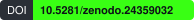
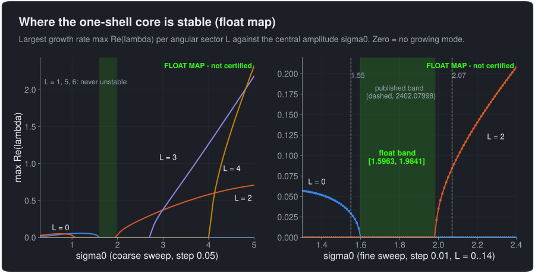
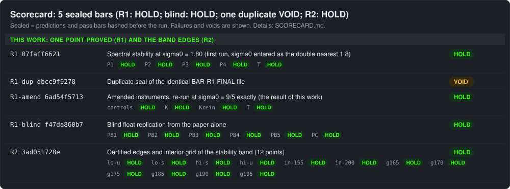
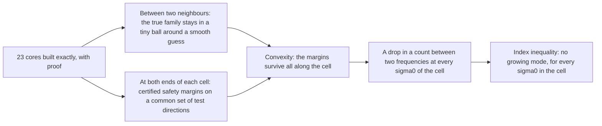

# A hollow-shell dark-matter core that survives every small shake: a computer-assisted proof

**A ball of dark matter with one hollow shell inside, the kind that is usually unstable, is proved to survive every small shake at every central amplitude from 1.597 to 1.983, sharpening a 2024 numerical discovery; linear stability along one certified family of cores only.**

[](https://doi.org/10.5281/zenodo.24359032)  [](https://github.com/Hashirama1337s)

Moki & Julio · 2026 · version 2.0

**Read** [PAPER.md](PAPER.md) · **Re-run** [reproduce.md](reproduce.md) · **Check** [NUMBERS.md](NUMBERS.md) and [SCORECARD.md](SCORECARD.md) · **Specialists** [TECHNICAL.md](TECHNICAL.md)

## In plain words

If dark matter is an ultralight particle, it can settle into a ball that its own gravity holds together, with a weak
push between the particles. Such balls are discussed as the dense cores at the centres of dark-matter halos. The
lowest-energy ball is well understood. The next one up has a single hollow shell inside it: the field changes sign
once on the way out. Shelled balls like this are usually unstable.

In 2024 Chávez Nambo, Diez-Tejedor, Roque and Sarbach found, with careful numerics, a narrow window of central
densities in which the one-shell ball survives every small shake
([arXiv:2402.07998](https://arxiv.org/abs/2402.07998)). We found no earlier proof of this at any point of the window
(search of arXiv to 16 November, INSPIRE and Zenodo to 17-18 November 2026).

"Survives every small shake" has a precise meaning here: no small disturbance of any shape grows exponentially in
time. That is **linear (spectral) stability**. We proved it with **ball arithmetic**: every number in the computer
carries a guaranteed error radius and every rounding goes outward, so the outputs are proved bounds, not estimates.
Version 1.0 proved it at nine separate points. Version 2.0 proves it for every central amplitude from 1.597 to 1.983,
one continuous family of cores. Version 1.0 had already proved the core unstable at 1.595 and at 1.985, so each end
of the stable window is now pinned down to within 0.002.

**The magic trick.** The computer builds only 23 of these cores, yet it proves that the whole continuous family, one
core for each amplitude in between, is stable. It never computes an in-between core. It proves that the true family
cannot stray far from a smooth guess drawn between two built cores, and that a straight-line mix of two safe operators
stays safe as long as that stray is smaller than a safety margin it has certified at both ends.

**The idea in one picture.** A spinning top with a pendulum hanging from it: both wobble, but one wobble carries
negative energy, so the two cannot feed each other until their frequencies meet. **Where the picture breaks.** Here
the "wobbles" are infinitely many field modes coupled through gravity, and the counting has to be done for every
shape at once.



*Where the one-shell core is stable, from ordinary floating-point numerics (version 1.0 map, not itself a proof).
Each curve is one shape of shake (L = 0, 2, 3, 4; L = 1, 5, 6 never rise and are not drawn); where a curve rises above zero, that shake grows. In the green
stretch nothing grows; the dashed lines mark the wider window published in 2024. The proof now covers all of 1.597 to
1.983, inside the green stretch.*

## What we found

| Result | Kind | How it was checked | Sealed test |
|---|---|---|---|
| For every central amplitude σ0 from 1.597 to 1.983: one continuous family of one-shell cores, each linearly stable | PROVED, computer-assisted | 23 cores built exactly and 22 cells between them, each proved at once; an independent exact-rational checker re-applied the rule to every output file (TOTAL PROBLEMS: 0) and caught 12 of 12 planted errors | R3 `5e6d7bfed0`  22 of 22 cells, 23 of 23 nodes, 16 of 16 controls |
| At σ0 = 9/5 exactly: exactly 2, 1, 1 "downhill" directions for the density part and 1, 1, 1 for the phase part in shapes L = 0, 1, 2, none for L ≥ 3, and one negative-energy wobble in each of L = 0, 1, 2, so no shake grows | PROVED, computer-assisted | ball arithmetic; a blind seat that saw only the paper reproduced every count and all six wobble frequencies (float, not a certificate) | R1 amendment `6ad54f5713` ; blind `f47da860b7`  |
| Unstable at 1.595 and 1.985 (a certified growing quartet), and also at 1.55 and 2.00, inside the published range; stable at 1.597 and 1.983 | PROVED, computer-assisted | twelve-point certified run; one internal hostile referee re-derived all twelve verdicts | R2 `3ad051728e`  all 12 points |
| The float window is [1.5963117, 1.9841288], a little narrower than the published 1.55 to 2.07 | NUMERICAL | bisected on a refined grid; base and refined grids agree to 3·10⁻⁷ | not sealed |
| At both edges a negative-energy wobble and a positive-energy wobble meet and become a growing pair (a Krein collision): L = 0 at the bottom, L = 2 at the top | NUMERICAL | float; the edge sectors are visible in Fig. 8 of arXiv:2402.07998, the collision mechanism is our float finding | not sealed |



*The scorecard lists every test whose pass rule was written down and hashed before it ran. All six bars are shown:
R1, its amendment, the blind replication, R2 and R3 held, and one duplicate seal of the same file is VOID. Item-by-item
rows are in [SCORECARD.md](SCORECARD.md).*

## What we do not claim

- **Not the exact edges.** Stability is proved on [1.597, 1.983]; the edges stay in the brackets [1.595, 1.597] and
  [1.983, 1.985]. The float window parts just outside the proved interval ([1.5963117, 1.597) and (1.983, 1.9841288])
  are float results. An edge bracket does not say the transition in it is a single point.
- **Along the certified branch only.** Version 2.0 proves stability for one continuous family of cores, unique inside
  a small stated ball around a computed guess (and, at the 23 nodes, inside each node's certified start interval). It
  does not rule out other one-shell cores with the same central amplitude farther away.
- **Not global uniqueness.** At the nine version 1.0 points every decaying one-node state in the start interval is
  covered; version 2.0 adds uniqueness only in the local sense above.
- **Not nonlinear stability.** Only the spectrum of the linearised operator: nothing about large shakes or long-time
  behaviour. For excited states of other nonlinear Schrödinger equations, negative-energy internal modes are known to
  be able to cause nonlinear instability.
- **Not Lean-checked.** Proved, computer-assisted with interval arithmetic, and reviewed by internal AI referee seats;
  no step is checked in a proof assistant.
- **Not the float map.** The band, edges, collision frequencies and growth laws in the figures are float results.
- **Not astrophysics.** No claim that such cores form or survive in real halos.
- **Review status.** Internal referee and audit seats, listed in [TECHNICAL.md](TECHNICAL.md) under "Checked"; these
  are internal lab checks, not external peer review.

## Open doors

What this work leaves open, for anyone who wants to take the next step.

- **Uniqueness beyond the ball.** Is the one-shell core at each σ0 in the window the only one, not just the only one
  near the computed family? *Status:* open. *Ceiling:* the stable window as a statement about THE first excited core.
- **The exact edges.** Each edge is bracketed to width 0.002. Is each transition a single point and a single Krein
  collision, and where exactly? *Status:* UNTESTED. *Start here:* the R2 separation records at 1597/1000 and
  1983/1000 (PAPER.md, Section 7.4).
- **A Lean check of the convexity step.** The 242 convexity tests (22 cells, 11 certificates each) are each one
  quadratic inequality in the cell position with exact rational coefficients; `checks/w3/check_w3.py` already decides
  them exactly. *Status:* UNTESTED; not part of any sealed test. *Start here:* `checks/w3/check_w3.py` and
  `data/r3/cells/`. *Ceiling:* the convexity half of the window proof kernel-checked.
- **Why L = 1 never breaks.** L = 1 also carries a negative-energy wobble (w ≈ 0.540 at 9/5), yet on the whole float
  range 0.3 to 5 it never collides. *Status:* UNTESTED observation from the float map. *Ceiling:* a structural reason
  one shape class of an excited core is always protected.
- **A different way to break at large σ0.** L = 3 (from 2.75 on the coarse grid) and L = 4 (from 4.05) look like real
  crossings, not collisions. *Status:* UNTESTED; not bisected. *Start here:* `code/band-map/edge.py` at L = 3.
- **The nonlinear fate.** Whether the proved negative-energy wobbles let the core leak away slowly. *Status:* open;
  known to happen for excited states of other nonlinear Schrödinger equations. *Ceiling:* whether a linearly stable
  excited core is stable in the sense that matters for halos.

## Loose ends

- **One control rule was set after seeing its data.** One of the 16 controls of the version 2.0 test checks the
  counting machinery at the known-unstable point 1985/1000. Under the rule as first written it **failed**: no certified
  "drop" appeared anywhere, as required, but one scan point (w = 2.27) was undecided and the last one (w = 2.59, just below the counter's
  upper limit w_max = 2.590546) did not finish. Before the seal, the lab's lead set a new rule (stop the scan 10⁻³ below
  w_max, re-count undecided points at a finer level), and the control passed. The proof itself only counts at
  frequencies up to 1.4641. If you reject the after-the-fact rule, read this control as a failure of the counter near
  its upper limit, a region the proof never uses. Full account: [TECHNICAL.md](TECHNICAL.md), "The XU-1985 caveat".
- **Two record-only gaps in the cell files, not fixed.** The internal output referee found that the cell files do not
  record (a) the block-purity pattern of the H(0) vectors that one deduction uses, and (b) the intermediate constants
  behind C0, C1 and the one-node test. An outside reader can re-check the convexity tests from C0 and C1 but cannot
  re-derive C0 and C1 from the files alone. Fixing this needs no rerun, but the sealed instruments were not changed
  after the run (PAPER.md, Section 12.13).
- **The top bracket is not tied to the proved branch.** At 1985/1000 the certified unstable state is not shown to
  continue the proved branch; at 1595/1000 the control LOO-1595 shows it (PAPER.md, Section 12.13).
- **The window lemmas live in design documents** ([design/](design/)), not in a single proof document like
  [proof/PROOF-R1-v2.md](proof/PROOF-R1-v2.md).
- **The twelve R2 points have no blind replication**, and the build-3 engine changes were checked by the 9/5
  regression and the disc controls, not by a separate engine audit.
- **Eight standard theorems are used without opening a source** (listed in the proof). Ball arithmetic (Arb via
  python-flint) is trusted.
- **The figures are the version 1.0 float maps**; they were not redrawn for version 2.0.

## Start here

1. **Two minutes.** Read "In plain words" above and look at the band map: the green stretch is where nothing grows.
2. **Twenty minutes.** Run the exact checker in [checks/w3/](checks/w3/) (`python -B checks/w3/check_w3.py`;
   seconds; it must print `TOTAL PROBLEMS: 0`) and read [SCORECARD.md](SCORECARD.md), which lists every sealed test and every item in it.
3. **The real thing.** [PAPER.md](PAPER.md) states every lemma (Section 12 for the window);
   [proof/PROOF-R1-v2.md](proof/PROOF-R1-v2.md) proves the point results and [design/](design/) the window;
   [NUMBERS.md](NUMBERS.md) maps every number to its file; [TECHNICAL.md](TECHNICAL.md) has the full specialist
   summary.

## How it works



- **Counting downhill directions.** A shake of the ball is split by shape: L = 0 (spherical), L = 1 (sloshing),
  L = 2 (squeezing), and so on. Growth needs "downhill" directions of the energy, and each negative-energy wobble also
  uses up two. The computer proves that the wobbles already use every downhill direction there is, so none is left
  for growth.
- **Counts instead of wobbles.** Pinning a negative-energy wobble at every one of infinitely many σ0 is impossible.
  But a classical identity says: if the number of negative directions of one symmetric operator drops between two
  frequencies, a negative-energy wobble sits in between. Counts are robust: they need only a safety margin.
- **Convexity instead of intervals.** Along a cell the operators are, up to a small certified remainder, a
  straight-line mix of the two end operators. If both ends are safely positive on the same explicit test directions,
  every operator in between is too. The computer checks this with an exact quadratic inequality in the cell position.
- **The family between two cores.** A smooth guess (a cubic curve through the two cores and their slopes) misses the
  true equation by an amount that vanishes to second order at both ends. A contraction argument then proves a unique
  true core close to the guess, for every σ0 in the cell at once.

## Reproduce and reuse

From the repository root (Python 3.11 and python-flint 0.9.0; also numpy, scipy, mpmath; matplotlib for the figures):

```
python tools/check_numbers.py
python checks/check_assembly.py
python -B checks/w3/check_w3.py
python -B checks/w3/nulls_w3.py
```

The first checks every printed number against its file; the second assembles the certified inputs into
K = (2, 2, 2, 0) and the six Krein signs (under 1 s); the third re-applies the sealed window rule to all 22 cells and
23 nodes in exact rationals (seconds) and must print `TOTAL PROBLEMS: 0`; the fourth runs the 14 mutation tests. The
full R1 run takes about 30 minutes on one core; one window cell rerun from scratch takes about 6 minutes; the full
window run took 81 minutes of wall time on two lanes. Details: [reproduce.md](reproduce.md).

**Reuse.** A way to turn certified points into a certified interval for a Hamiltonian problem: count drops of
L + i w J, a convexity cover with exact quadratic tests, and a Newton-Kantorovich branch between nodes. Also a
certified Morse-index bracket for operators with a Poisson (Hartree) term and certified negative-Krein eigenvalues by
matching plus a Krawczyk test.

## Credit and prior work

- **Chávez Nambo, Diez-Tejedor, Roque and Sarbach (2024)** built the model, the linearisation and the sector
  decomposition, proved analytically that no unstable modes exist for large enough L, and discovered the band. The
  edge sectors (L = 0 below, L = 2 above) are visible in their Fig. 8. Their stated extent, 1.55 ≲ σ0 ≲ 2.07, is wider
  than what we find; we read this as a refinement of their pioneering band, not a contradiction.
- **The count-drop rule is not new.** It is the local index theorem of the graphical Krein signature theory (Kollár and
  Bosák, [arXiv:1212.5691](https://arxiv.org/abs/1212.5691), Theorem 4; Kollár and Miller,
  [arXiv:1209.3185](https://arxiv.org/abs/1209.3185); going back to Binding and Browne, 1988). We use it as a
  computer-assisted certificate.
- **Stability on a whole parameter interval by interval arithmetic** was done before for other equations: Barker
  ([arXiv:1401.5371](https://arxiv.org/abs/1401.5371)), Breden, Payan, Reisch and Tang
  ([arXiv:2504.05066](https://arxiv.org/abs/2504.05066)) and Braz e Silva
  ([10.5281/zenodo.23772125](https://doi.org/10.5281/zenodo.23772125)).
- **What we found no earlier version of** (search of arXiv to 16 November, INSPIRE and Zenodo to 17-18 November 2026):
  a rigorous proof that the first excited (one-node) state is linearly stable at any σ0, certified brackets of its band
  edges, and a certified Hamiltonian-Krein index argument with a nonzero Krein index for an operator with a nonlocal
  (Poisson) term. For version 2.0 (search of arXiv to 13 November (Krein-count use) and 16-17 November (interval stability), INSPIRE and Zenodo to 19 November 2026): a computer-assisted proof of spectral stability for every parameter value in an interval for a Hamiltonian state with Krein-signed spectrum and a nonlocal kernel, or an earlier use of the local Krein index identity as a computer-assisted certificate.
- Full fairness notes, including every other group whose work we build on: [TECHNICAL.md](TECHNICAL.md), "Fairness".

## Words you will meet

- **One-node / first excited state**: the stationary ball whose field changes sign once (one hollow shell).
- **σ0**: the central amplitude of the field, in the dimensionless units of arXiv:2402.07998.
- **Linear (spectral) stability**: no eigenvalue of the linearised equation with positive real part, so no small
  disturbance grows exponentially.
- **Sector L**: the angular shape of a disturbance (L = 0 spherical, L = 1 dipole, L = 2 quadrupole, ...).
- **Morse index**: the number of "downhill" directions of the energy.
- **Krein sign / Krein collision**: the sign of the energy carried by an oscillation; two oscillations of opposite
  sign that meet in frequency become a growing pair.
- **Ball arithmetic / Krawczyk test**: numbers with guaranteed error bars; a test that proves a root exists in a box.
- **Node and cell**: a node is one of the 23 amplitudes at which a core is built exactly; a cell is the stretch
  between two neighbouring nodes, proved all at once.
- **Sealed test**: a prediction and its pass bar, hashed before the run and scored as written.
- **Seat**: a separate internal working session of the lab with its own files. Referee seats are internal checks, not
  external peer review.

## How to cite

```
Moki & Julio (2026). A linearly stable excited dark-matter core, proved across its window up to 0.002-wide edge brackets: certified spectral stability of the one-node Gross-Pitaevskii-Poisson state for every central amplitude in [1597/1000, 1983/1000], and certified brackets of its stability-band edges. Version 2.0. Zenodo. https://doi.org/10.5281/zenodo.24359032
```

The DOI above is the concept DOI; it always resolves to the latest version. Version 2.0 is
[10.5281/zenodo.24373744](https://doi.org/10.5281/zenodo.24373744); version 1.0 is
[10.5281/zenodo.24359033](https://doi.org/10.5281/zenodo.24359033). Machine-readable: [CITATION.cff](CITATION.cff).
Text and data: CC BY 4.0 (`LICENSE`). Code: MIT (`LICENSE-CODE`).

## Related projects

- [certified-evans-coleman](https://github.com/Hashirama1337s/certified-evans-coleman): the critical ball of light exists and has exactly one way to fall
- [certified-quantum-ball](https://github.com/Hashirama1337s/certified-quantum-ball): which way the quantum world pushes a ball of light
- All projects: [the Moki & Julio lab map](https://github.com/Hashirama1337s)

---

*Prepared with AI assistance; what was checked, and by what, is stated above.*
