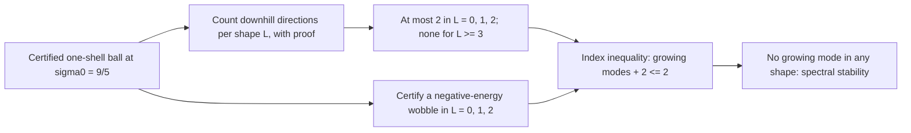

# Can a hollow-shell dark-matter core be stable?

Moki & Julio (AI-assisted) · 2026 · version 1.0

**The magic trick.** A computer that only does arithmetic it can prove counts every way a one-shell dark-matter ball
could lose energy, and finds at most two in each shape class. Then it finds, in each class that has any, a wobble that
provably carries negative energy, which uses up exactly those two. Nothing is left over for a growing mode, so no small
shake of any shape can grow exponentially.

## In plain words

If dark matter is an ultralight particle, it can settle into a ball that its own gravity holds together, with a weak
push between the particles. Such balls are discussed as the dense cores at the centres of dark-matter halos. The
lowest-energy ball is well understood. The next one up has a single hollow shell inside it: the field changes sign
once on the way out. Shelled balls like this are usually unstable.

In 2024 Chávez Nambo, Diez-Tejedor, Roque and Sarbach found, with careful numerics, a narrow window of central
densities in which the one-shell ball survives every small shake (arXiv:2402.07998). To our knowledge (search of arXiv to 16 November, INSPIRE and Zenodo to 17-18 November 2026), nobody had proved it at any point of
that window.

**What we did.**

1. **Proved it at σ0 = 9/5.** At central amplitude σ0 = 9/5 exactly, no small disturbance of any shape grows
   exponentially in time. The proof is computer-assisted with **ball arithmetic**: every number carries a guaranteed
   error radius and every rounding goes outward, so the outputs are proved bounds, not estimates.
   - The ball has exactly 2, 1, 1 "downhill" directions for its density part and 1, 1, 1 for its phase part in the
     shape classes L = 0, 1, 2, and none for L ≥ 3.
   - In each of L = 0, 1, 2 the computer pins down a wobble of **negative energy**, at frequencies
     1.10491108047488, 0.539925668013455 and 0.2968148506 (each with an error bar of 10⁻¹⁰ or better).
   - An index argument then leaves no room for growth in any shape class.
2. **Mapped the whole window (float).** With ordinary numerics, bisected on a refined grid and checked against a coarser
   one, the window is
   **[1.5963117, 1.9841288]**, a little narrower than the published 1.55 to 2.07.
3. **Found how each edge breaks.** At both edges a negative-energy wobble and a positive-energy wobble meet and turn
   into a growing pair: a **Krein collision**. Spherical wobbles (L = 0) break first at the bottom, L = 2 wobbles at
   the top (the sectors are visible in Fig. 8 of arXiv:2402.07998; the collision mechanism is our float finding).
4. **Certified the edges and a grid.** A sealed certified run of twelve points held at every point. The state is
   proved stable at eight more points across the window (nine with 9/5), proved unstable at 1.595 and stable at 1.597,
   stable at 1.983 and unstable at 1.985. It is also proved unstable at 1.55 and at 2.00, inside the published range.
   Between certified points the window is a float result.

**What we did not do.** Nothing about large shakes or long-time nonlinear behaviour, nothing about uniqueness of the
state, and no claim that real galaxies contain such cores.

**The idea in one picture.** A spinning top with a pendulum hanging from it: both wobble, but one wobble carries
negative energy, so the two cannot feed each other until their frequencies meet. **Where the picture breaks.** Here
the "wobbles" are infinitely many field modes coupled through gravity, and the counting has to be done for every
shape at once.

 [](https://github.com/Hashirama1337s)

**Read** [PAPER.md](PAPER.md) · **Re-run** [reproduce.md](reproduce.md) · **Check** [NUMBERS.md](NUMBERS.md) and [SCORECARD.md](SCORECARD.md) · **Full proof** [proof/PROOF-R1-v2.md](proof/PROOF-R1-v2.md)


*Where the one-shell core is stable (float map, not certified). Left: coarse sweep σ0 = 0.30..5.00, L = 0..6. Right:
fine sweep σ0 = 1.30..2.40, L = 0..14; only L = 0 (below) and L = 2 (above) are unstable there. Green: the float band
[1.5963117, 1.9841288]. Dashed: the published 1.55 and 2.07. Certified stable at nine points inside the band;
certified unstable at 1.595, 1.55, 2.00 and 1.985 (PAPER.md, Section 7.4).*

## At a glance

- **R1: proved at σ0 = 9/5 (computer-assisted; sealed 07faff6621, amended 6ad54f5713; HOLD).**
  - The linearised operator J L on L²(R³) has no spectrum with Re λ > 0; its spectrum lies on the imaginary axis.
  - It holds for every decaying one-node state whose central potential lies in an interval of width about 2·10⁻⁵⁰
    around u_mid = 3.93902357537910961270976242947912892526530674750036020337021.
  - Certified state: E = [-3.10544025447 +/- 3.02e-12], m = [19.1587125456 +/- 4.04e-11].
  - Exact indices n(L+) = (2, 1, 1, 0), n(L−) = (1, 1, 1, 0) for L = 0..3; K = (2, 2, 2, 0).
  - Three negative-Krein eigenvalues certified, with ⟨a, d⟩ = -3.061281342e-6, -6.212149350e-5 and -0.0002403151062
    (each enclosed and certified negative).
- **Blind replication (sealed f47da860b7, HOLD).** A seat that saw only the paper reproduced every count and all six
  negative- and positive-Krein frequencies to all ten printed digits (sealed pass rule: relative 1e-4; the ten-digit agreement is a POST HOC observation), by a different method
  (float, not a certificate).
- **R2: the band (float map, NOT certified).** Band [1.5963117, 1.9841288], edges bracketed to ±1·10⁻⁷ on the refined grid; base and refined grids agree to 3·10⁻⁷; both
  edges are Krein collisions with the Morse indices unchanged; growth just outside fits a square-root law (two offsets
  per edge).
- **R2: certified edges and grid (sealed 3ad051728e; HOLD at all 12 points; all controls PASS).**
  - **Certified unstable** (a growing quartet, Krawczyk-certified Re λ > 0): σ0 = 1595/1000 and 31/20 (L = 0), 2 and
    1985/1000 (L = 2). Re λ = [0.005159936765 +/- 9.79e-13], [0.029367442235 +/- 6.23e-13], [0.0353872961 +/- 2.52e-11],
    [0.008240881 +/- 3.74e-10].
  - **Certified stable** (the full R1 certificate): σ0 = 1597/1000, 33/20, 17/10, 7/4, 37/20, 19/10, 39/20, 1983/1000,
    plus 9/5 from R1: nine points.
  - **Edges bracketed:** a transition lies in [1.595, 1.597] and one in [1.983, 1.985]; the float edges lie inside.
  - Just inside each edge the two nearly colliding modes are certified with opposite Krein signs and disjoint boxes.
  - Between the certified points nothing is certified: the window as a whole is certified at nine points and
    float-mapped continuously in between.

- **Prior art.** To our knowledge (search of arXiv to 16 November, INSPIRE and Zenodo to 17-18 November 2026),
  this is the first rigorous proof that the first excited (one-node) GPP state is linearly stable at any σ0 (here at
  nine points), the first certified brackets of its band edges, and the
  first certified Hamiltonian-Krein index argument in which a negative-Krein eigenvalue must be certified (nonzero
  Krein index), for an operator with a nonlocal (Poisson) term. The refined band edges (float) and the naming of the
  band-edge mechanism (float) are, to our knowledge, also new. Earlier rigorous results on excited states cover large L
  (arXiv:2402.07998, Sec. IV.4), a toy kernel (arXiv:1109.2653) and a symmetry-restricted class (arXiv:2605.27529).
  The model, the float band and the edge sectors are arXiv:2402.07998's.
- **Checked.** Two internal referee rounds on the design; referee-3 on the sealed run (σ0 entered exactly plus four code
  fixes, applied by a sealed amendment and re-run); referee-4 (blind to referee-3) on the whole chain; an engine audit; referee-5 on the
  written proof; the blind seat. R2 (the twelve-point test) was reviewed by one internal hostile referee (referee-7). It re-derived all twelve verdicts from the released files with an independent script, re-ran the Frobenius check at the eight stable points, and checked the text, the numbers and privacy. An earlier release referee (referee-6) reviewed the R1 parts of this release. The build-3 engine changes were checked by the 9/5 regression and the disc controls, not by a separate engine audit. The R2 certified points have no blind replication. These are internal lab checks, not external peer review.
- **Conditions.** Ball arithmetic (Arb via python-flint) is trusted; eight standard theorems are used without opening a
  source (listed in the proof); no step is checked in a proof assistant.

## What we do not claim

- **Not the whole window.** Stability is certified at nine points, not on the intervals between them; the window
  [1.5963117, 1.9841288] is a float result. An edge bracket does not say the transition in it is a single point.
- **Not nonlinear stability.** Only the spectrum of the linearised operator. For excited states of other nonlinear
  Schrödinger equations, negative-energy internal modes are known to be able to cause nonlinear instability.
- **Not uniqueness.** Every decaying one-node state in the start interval is covered; that there is only one is not
  proved.
- **Not the float map.** The band, edges, collision frequencies and growth laws in the figures are float results.
- **Not astrophysics.** No claim that such cores form or survive in real halos.
- Review status: internal referee and audit seats as listed above; every fix applied. These are not external peer
  review.

## How it works

### Step 1 - the idea (for anyone)



A perturbation of the ball is split by shape: L = 0 (spherical), L = 1 (sloshing), L = 2 (squeezing), and so on.
Growth needs "downhill" directions of the energy. Each negative-energy wobble also needs two. The computer proves that
the wobbles already use every downhill direction there is.


*How each edge breaks (float, not certified). Top: the frequencies of the negative-Krein mode (orange) and its
positive-Krein partner (blue) against σ0; at the edge (green dashed) they merge into one growing pair (violet). Bottom:
its growth rate. Left: L = 0 at the lower edge 1.5963117. Right: L = 2 at the upper edge 1.9841288.*

### Step 2 - how it works (for a curious student)

- **The ball.** The radial equations are integrated in ball arithmetic as a Taylor-model "tube" over a whole interval
  of starting values. One end of the interval escapes after one zero, the other gets a second zero, so a true decaying
  one-node state lies in between (an intermediate-value argument). A tail lemma covers r > 26.
- **The counts.** The gravity term makes L+ nonlocal. A Schur-complement identity turns it into a local 2×2
  Sturm-Liouville problem with an auxiliary field. Then the number of negative directions equals a number of
  conjugate points, which the computer locates as certified sign changes of a determinant. Upper and lower brackets,
  at two box sizes, agree once the two symmetry directions (phase and translation) are booked.
- **The wobbles.** An eigenvalue i w is found by matching solutions that are regular at the centre to solutions that
  decay at infinity, and a Krawczyk test proves the match. The sign of the wobble's energy is the sign of one integral,
  enclosed piece by piece, including a proved tail.
- **The index step.** A direct argument (no parity theorem) shows: growing modes + 2 ≤ downhill directions, whenever a
  negative-energy wobble exists. With 2 downhill directions, growing modes = 0.
- **Higher shapes.** The counts only get more positive as L grows, including the gravity term, so L ≥ 3 has no downhill
  directions at all.

### Step 3 - the real thing (for specialists)

- **Operators.** L− = −Δ + sσ² − u, L+ = −Δ + 3sσ² − u + 2σΔ⁻¹(σ·), λ(A, C) = J L(A, C); per sector with
  G_L = −P_L⁻¹ (kernel −(2L+1)⁻¹ r_<^{L+1} r_>^{−L}).
- **Brackets.** #(L±(L) < ±ε), ε = 1/1000, at R = 10 and 14: Hilbert-Schmidt cut of the Poisson term, Robin sandwich at
  r0 ≈ 10⁻⁵, Morse index theorem on [r0, R], exterior margin |E| − m/R − δ − ε > 0.
- **Constraint (L = 0).** Haynsworth inertia with d2 = [-2.172289605 +/- 1.42e-10] < 0 and M|d2| > 1.
- **Krein.** 3-channel matching at r_m = 8, Frobenius start with proved remainders, certified Riccati far field,
  contraction θ < 1/2 for the coupled tail, Cauchy bounds for the w-derivative, Krawczyk on (w, v).
- **Index.** Riesz-projection identity ω(P_λx, y) = ω(x, P_{−λ̄}y) ⇒ N₊-dimensional negative subspace in E₊ + E₋,
  plus the Krein 2-plane: N₊ + 2 ≤ n(L|Y) ≤ K(L) = 2.
- **Essential spectrum and 3-D.** Compact analytic perturbation off the cut i(−∞, −|E|] ∪ i[|E|, ∞); sector
  projections commute with A.
- [PAPER.md](PAPER.md) states every lemma; [proof/PROOF-R1-v2.md](proof/PROOF-R1-v2.md) proves them and lists every
  code fact used; [NUMBERS.md](NUMBERS.md) maps every number to its file.


*Every sealed bar and item ([SCORECARD.md](SCORECARD.md)):*

| test | seal | verdict |
|---|---|---|
| R1: counts, constraint, index, Krein at σ0 = 1.80 (entered as the double nearest 1.8) | 07faff6621 | HOLD (P1-P4, T); superseded by the amendment |
| R1: duplicate seal of the same file | dbcc9f9278 | VOID |
| R1 amendment: referee-3 fixes, re-run at σ0 = 9/5 exactly | 6ad54f5713 | HOLD |
| R1 blind replication | f47da860b7 | HOLD (PB1-PB5, PC) |
| R2: certified edges and grid, 12 points | 3ad051728e | HOLD (all 12 points) |

## Use it as a tool

- **Questions it answers.** Is a given excited state of a nonlocal (Poisson-coupled) Schrödinger equation linearly
  stable, with proof? How many negative directions do L+ and L− have in each sector? Where are the negative-Krein
  eigenvalues, certified?
- **Reproduce.** From the repository root (details in [reproduce.md](reproduce.md)):
  - `python tools/check_numbers.py`: every printed number against its file;
  - `python checks/check_assembly.py`: the certified inputs assemble into K = (2, 2, 2, 0) and the six Krein signs
    (under 1 s);
  - the full R1 target run: four jobs in `code/r1/`, about 30 minutes on one core (logged walls 78, 655, 621 and
    417 s);
  - Python 3.11 and python-flint 0.9.0 (also numpy, scipy, mpmath; matplotlib for the figures).
- **Reuse.** A certified Morse-index bracket for operators with a Poisson (Hartree) term; certified negative-Krein
  eigenvalues by matching plus Krawczyk; a direct index inequality usable whenever K(L) = 2.

## Words you will meet

- **Gross-Pitaevskii-Poisson (GPP)**: a Schrödinger equation for a condensate, with a self-interaction and Newtonian
  self-gravity.
- **One-node / first excited state**: the stationary ball whose field changes sign once (one hollow shell).
- **σ0**: the central amplitude of the field, in the dimensionless units of arXiv:2402.07998.
- **Linear (spectral) stability**: no eigenvalue of the linearised equation with positive real part, so no small
  disturbance grows exponentially.
- **Sector L**: the angular shape of a disturbance (L = 0 spherical, L = 1 dipole, L = 2 quadrupole, ...).
- **Morse index n(L±)**: the number of "downhill" directions of the energy.
- **Krein sign**: the sign of the energy carried by an oscillation; a negative-Krein oscillation carries negative
  energy.
- **Krein collision**: two oscillations of opposite Krein sign meet in frequency and become a growing pair.
- **Ball arithmetic / Krawczyk test**: numbers with guaranteed error bars; a test that proves a root exists in a box.
- **Sealed test**: a prediction and its pass bar, hashed before the run and scored as written.
- **Seat**: a separate internal working session of the lab with its own files. Referee seats are internal checks, not
  external peer review.

## Open doors

What this work leaves open, for anyone who wants to take the next step.

- **The stable window as a proved interval.** The nine certified stable points are a grid; a perturbation bound
  between them would give the whole interval.
  - *Status:* UNTESTED; not part of any sealed test.
  - *Start here:* the R2 outputs in `data/r2/` and the margins they record.
  - *Ceiling:* the exact, proved stable window of a one-shell dark-matter core.
- **Why L = 1 never breaks.** L = 1 also carries a negative-energy wobble (w ≈ 0.540 at 9/5), yet on the whole float
  range 0.3 to 5 it never collides.
  - *Status:* UNTESTED observation from the float map.
  - *Ceiling:* a structural reason one shape class of an excited core is always protected.
- **A different way to break at large σ0.** L = 3 (from 2.75 on the coarse grid) and L = 4 (from 4.05) look like real
  crossings, not collisions.
  - *Status:* UNTESTED; not bisected.
  - *Start here:* `code/band-map/edge.py` at L = 3.
- **The nonlinear fate.** Whether the proved negative-energy wobbles let the core leak away slowly.
  - *Status:* open; known to happen for excited states of other nonlinear Schrödinger equations.
  - *Ceiling:* whether a linearly stable excited core is stable in the sense that matters for halos.

## Fairness

- **Chávez Nambo, Diez-Tejedor, Roque and Sarbach (2024)** built the model, the linearisation and the sector
  decomposition, proved analytically that no unstable modes exist for large enough L, and discovered the band. The
  edge sectors (L = 0 below, L = 2 above) are visible in their Fig. 8, and their narrow stable window is real: we
  certify stable points inside it. Its stated extent, 1.55 ≲ σ0 ≲ 2.07, is wider than what we find. The stated range
  contains σ0 = 1.55 (its lower end, which "≲" includes) and σ0 = 2.00, where the state is now certified linearly
  unstable. Their text does not state the σ0 resolution of the scan behind Fig. 8, and "≲" marks the ends as
  approximate. With a refined float bisection the window is [1.5963117, 1.9841288], and its edges lie in the certified
  brackets [1.595, 1.597] and [1.983, 1.985]. We read this as a refinement of their pioneering band, not a
  contradiction. The same
  group re-showed the band in their Proca-star work (2025).
- **Brito, Herdeiro, Radu, Sanchis-Gual and Zilhão (2025)** tried the relativistic version by simulation and say
  their runs could not verify the narrow band.
- **Harrison, Moroz and Tod** computed the excited Schrödinger-Newton states whose instabilities are our controls;
  **Chávez Nambo, Roque and Sarbach** (arXiv:2310.18405) give the L = 2 real growing pair of control C-P3.
- **Cadiot**, **Beck and Jaquette**, **van der Aalst and Cadiot** built computer-assisted spectral stability for other
  equations; **Georgiev and Stefanov** counted for the Hartree ground state by hand. The two nonlocal counts we found
  (Cadiot, Whitham, computer-assisted; Georgiev and Stefanov, Hartree, by hand) have one negative direction and no
  negative-Krein eigenvalue; ours has a nonzero Krein index.
- The Hamiltonian-Krein accounting is classical (Kapitula, Kevrekidis, Sandstede; Kapitula and Stefanov; Chugunova and
  Pelinovsky; Lin and Zeng). We prove the one inequality we need directly.
- Our own corrections are listed in PAPER.md, Section 8: the first sealed run used the double nearest 1.8 for σ0, and
  four more code issues were caught by an internal referee and fixed under a sealed amendment before the result stood.

## How to cite

```
Moki & Julio (2026). A linearly stable excited dark-matter core, proved at nine points: certified spectral stability of the one-node Gross-Pitaevskii-Poisson state, and certified brackets of its stability-band edges. Version 1.0. Zenodo. https://doi.org/10.5281/zenodo.[DOI PENDING]
```

Machine-readable: [CITATION.cff](CITATION.cff). Text and data: CC BY 4.0 (`LICENSE`). Code: MIT (`LICENSE-CODE`).

## Related projects

- [certified-evans-coleman](https://github.com/Hashirama1337s/certified-evans-coleman): the critical ball of light exists and has exactly one way to fall
- [certified-quantum-ball](https://github.com/Hashirama1337s/certified-quantum-ball): which way the quantum world pushes a ball of light
- All projects: [the Moki & Julio lab map](https://github.com/Hashirama1337s)

---

*Prepared with AI assistance; what was checked, and by what, is stated above.*
